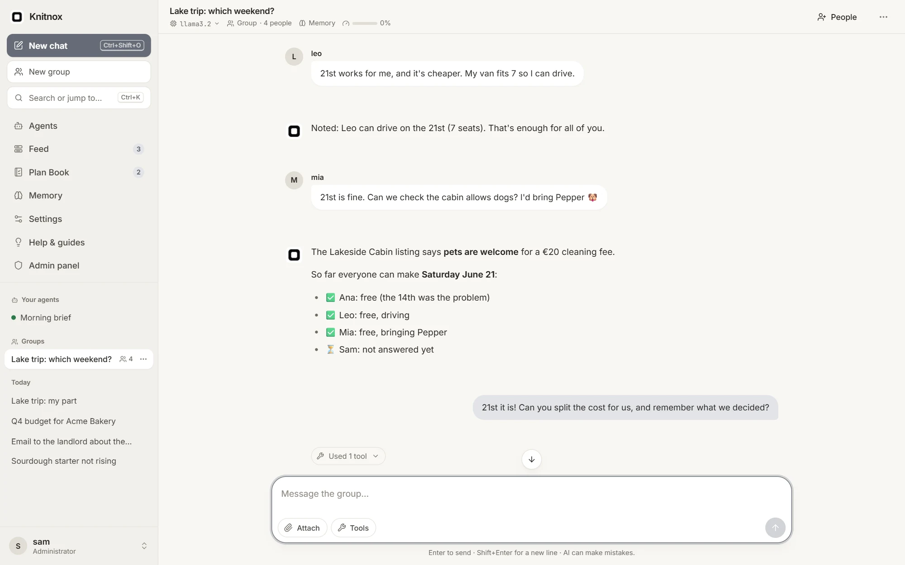
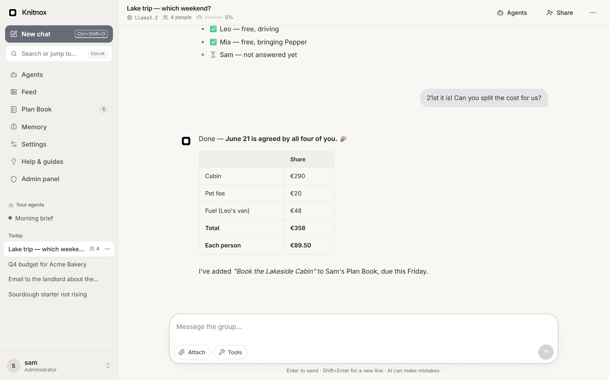
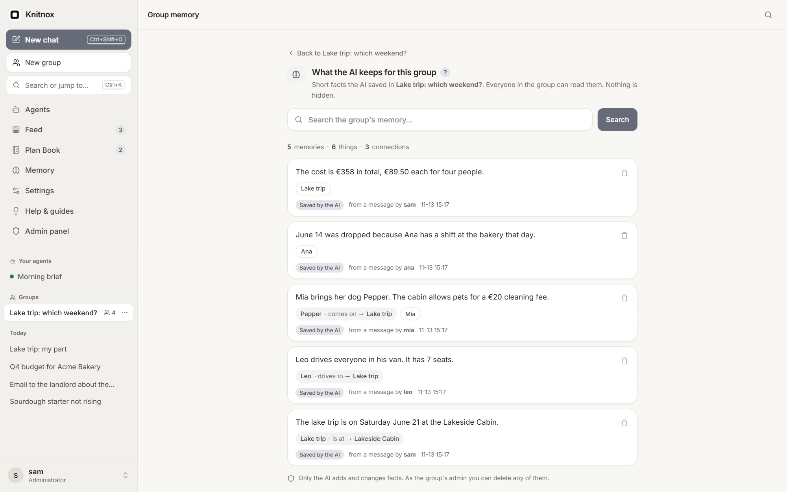
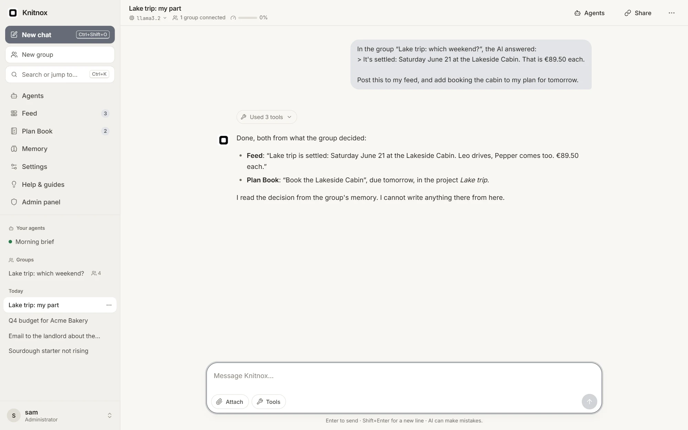
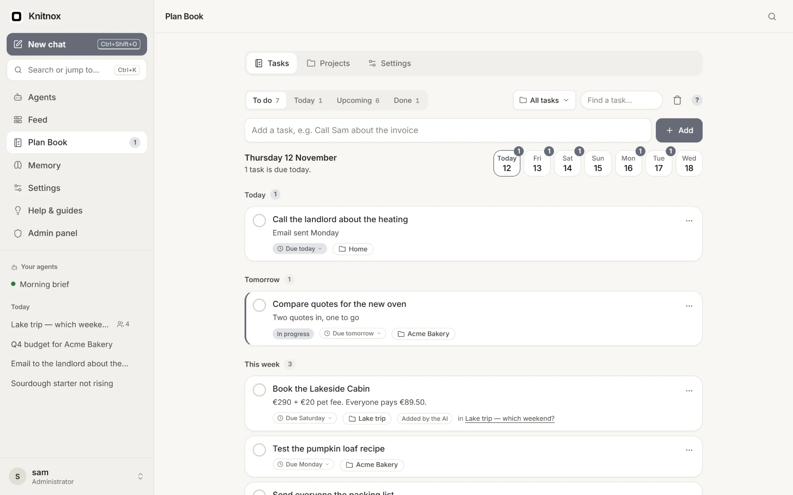
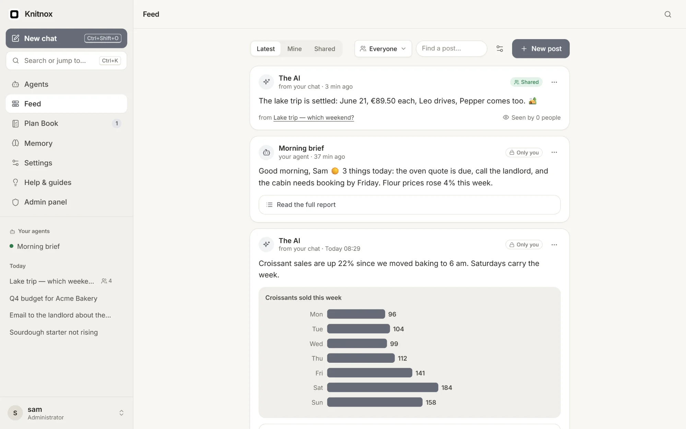
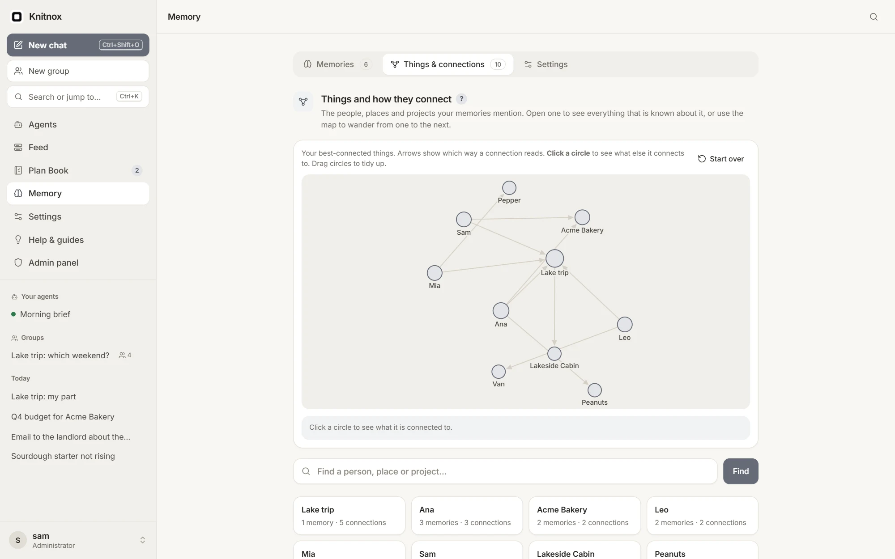

<div align="center">


# Knitnox

### Decide together. With AI in the room.

A private AI harness for personal use or a small pro-AI team.<br>
One program, one portable database, any local or cloud model.<br>
Ask together, ask in private, or let it work around the clock.

[](https://github.com/knitnox/knitnox/actions/workflows/test.yml)


[**Website**](https://knitnox.github.io/) · [**Download**](#download) · [Quick start](#quick-start-from-source-no-api-key-needed) · [User guide](docs/USER_GUIDE.md) · [Features](docs/FEATURES.md) · [Developer guide](docs/DEVELOPER_GUIDE.md)

<br>

<picture>
  <source srcset="docs/screenshots/chat-dark.webp" media="(prefers-color-scheme: dark)">
  
</picture>

</div>

<br>

> **"Well, ChatGPT told me…" "Gemini said the opposite."**
> In Knitnox your people and one AI are in the same chat. Everyone sees the same answer at the same time. Ask together, agree together.

## What it is for

Everyday problems, at work, in a club or at the kitchen table, and the part of Knitnox that solves each:

| What people say | The part that solves it |
|---|---|
| "ChatGPT said this." "Gemini said the opposite." | **Groups**: everyone asks in one chat and sees the same answer |
| "Wait, didn't we change that last week?" | **Group memory**: what was agreed, and whose message it came from |
| "I did not follow, but I will not ask in front of everybody." | **Take to my chat**: a chat of your own that points at the group. Nobody in the group sees it |
| "Who asked me to do this? And by when?" | **Plan Book**: your tasks, each with who added it |
| "Sorry, I missed that. I was busy." | **Feed**: your chats and agents post short updates in one place |
| "I told you that already." | **Memory**: your own memory. Tell the AI once and it knows it in all of your own chats |
| "Nobody checked. I forgot to look." | **Agents**: helpers that work by themselves around the clock, or when you ask, and report to your Feed |
| "It cannot do that. It is only a chatbot." | **Tools (MCP)**: connect a tool server and the AI can act, not only talk. Anything a tool server exists for can be added |

It is for any few people who decide things together: a small team, a club or a class, friends and family. One person starts it, the others open a link. It is just as much a personal tool.

## Two ways to use it, two ways to run it

| | |
|---|---|
| **With your people** | A group is a small parliament with the AI as its speaker: everyone gets a turn, it answers each person by name and keeps track of what was agreed. Use it to brainstorm or to settle a question. |
| **In private** | Open a chat of your own that points at the group and ask what you did not want to ask in front of everyone. Nobody in the group sees it. Or use Knitnox entirely on your own. |
| **On demand** | A normal chat: you write, it answers. |
| **Around the clock** | Agents work by themselves on a schedule, 24 hours a day, and report to your Feed. You set the limits, choose the tools and can pause one at any time. |

Every person has their own Memory, Plan Book and Feed. It all runs from a single program with one portable database file, on a local model or a cloud provider.

## How it fits together

```text
  SHARED: everyone in the group sees it
  ┌────────────────────┐      ┌──────────────────────────────┐
  │ Group              │ ───▶ │ Group memory                 │
  │ everyone asks,     │      │ what was decided, and by whom│
  │ one AI answers     │      └──────────────────────────────┘
  └────────────────────┘
            │  Take to my chat  (one way: reads the group, never writes to it)
            ▼
  YOURS ALONE: every person has their own, nobody else sees it
  ┌────────────────────┐      ┌───────────┐ ┌──────┐ ┌────────┐
  │ Your own chat      │ ───▶ │ Plan Book │ │ Feed │ │ Memory │
  │ "post this,        │      └───────────┘ └──────┘ └────────┘
  │  add that"         │                       ▲
  └────────────────────┘      Agents ──────────┘  helpers on a schedule
```

The group is shared. The rest is yours. One bridge carries a decision from the group to your own chat, and nothing private flows back.

---

## 1. Chats and groups

A **chat** is you and the AI. A **group** is one chat for several people. There **the AI works like the speaker of a small parliament**: everyone gets a turn, it answers each person by name and keeps track of who said what.

| | |
|---|---|
| **Solves** | "ChatGPT said this, Gemini said that." In a group there is one answer, and everyone saw it. Use it to brainstorm or to settle a question. |
| **How it works** | Start a group and send the invite link. Everyone writes in the same place and one AI model answers. Whoever started the group chooses the model. |
| **Who sees it** | Your own chat: only you. A group: the people you invited. |
| **Connects to** | Every group has its own memory (2). Anything said there can be taken to your own chat (3). |

- Answers keep coming after you close the tab; up to 10 messages wait in line
- Attach PDFs, photos, code and notes; the AI can draw pictures and read answers aloud
- Thinking models show their reasoning in a fold-away block; tool use stays out of the way as one line you can open
- Show one of your own chats to anyone with a read-only link, no account needed

<p align="center">
<picture>
  <source srcset="docs/screenshots/chat-end-dark.webp" media="(prefers-color-scheme: dark)">
  
</picture>
</p>

## 2. Group memory

While you talk, the AI writes down **what the group agrees on**: the date, who does what, what it costs. Anyone in the group can open the list at any time.

| | |
|---|---|
| **Solves** | "Didn't we change that?" "Who said that?" Each fact shows whose message it came from, and when. |
| **How it works** | Only the AI writes there, so nobody can quietly slip a "decision" in. When something changes, tell the AI in the group and it corrects the fact. A wrong fact can be deleted. |
| **Who sees it** | Everyone in the group, and nobody outside it. |
| **Connects to** | It belongs to the group (1), not to one person. Your own chat can read it when you take something with you (3). |

<p align="center">
<picture>
  <source srcset="docs/screenshots/groupmem-dark.webp" media="(prefers-color-scheme: dark)">
  
</picture>
</p>

## 3. Take to my chat

A chat of your own that **points at the group**. Nobody in the group sees it. Ask what you did not want to ask in front of everyone, or act on what was decided.

| | |
|---|---|
| **Solves** | "I did not follow, but I will not ask in front of everybody." Ask here instead: "what did we decide, and why?" And when a decision needs doing, say "post this to my feed and add it to my plan". |
| **How it works** | Click the arrow under any message in a group. A chat of your own opens with that message quoted. It can read the group's memory and latest messages. It cannot write there. |
| **Who sees it** | Only you. Your questions and the answers never reach the group. |
| **Connects to** | It is the bridge from the group (1, 2) to your own Plan Book (4), Feed (5) and Memory (6). |

<p align="center">
<picture>
  <source srcset="docs/screenshots/connect-dark.webp" media="(prefers-color-scheme: dark)">
  
</picture>
</p>

## 4. Plan Book

Your own tasks, each with a due date, grouped into projects if you like. Add them yourself, or **ask the AI in a chat to add them**.

| | |
|---|---|
| **Solves** | "Who asked me to do this, and by when?" Every task shows who added it (you, the AI or an agent) and which chat it came from. |
| **How it works** | Today, tomorrow and this week at a glance. A bin and a history of every change, so nothing disappears. |
| **Who sees it** | Only you. An agent can read or change it if you allow that agent. |
| **Connects to** | Filled from your chats (3). An agent can read it and remind you in your Feed (5). |

<p align="center">
<picture>
  <source srcset="docs/screenshots/plan-dark.webp" media="(prefers-color-scheme: dark)">
  
</picture>
</p>

## 5. Feed

Like a social feed, but **just for you**. Short posts from you, from the AI in your chats and from your agents, newest first.

| | |
|---|---|
| **Solves** | "I missed that, I was busy." You stop checking five tools every morning. The news comes to you. |
| **How it works** | A post can carry a report, a chart, a picture or a voice recording. The AI and your agents post only after you allow it. |
| **Who sees it** | Only you, until you share a post with everyone on your server. |
| **Connects to** | Decisions you took from a group (3), and what your agents found. A morning brief can read your Plan Book (4). |

<p align="center">
<picture>
  <source srcset="docs/screenshots/feed-dark.webp" media="(prefers-color-scheme: dark)">
  
</picture>
</p>

## 6. Memory

Your **own** memory, used in every chat of yours and separate from any group's. Tell the AI once that Ana is allergic to peanuts and it knows from then on.

| | |
|---|---|
| **Solves** | "I told you that already." You stop repeating yourself and starting every chat from zero. |
| **How it works** | Off until you switch it on. People, places and projects are linked on a map you can explore. Read, change, pin or delete anything it knows. |
| **Who sees it** | Only you. An agent can read it if you allow that one agent, and can never change it. |
| **Connects to** | Used in your own chats only (3), never in a group (1). |

<p align="center">
<picture>
  <source srcset="docs/screenshots/memory-dark.webp" media="(prefers-color-scheme: dark)">
  
</picture>
</p>

## And also

| | |
|---|---|
| **Agents** | Background helpers with their own instructions, tools and to-do list. On a schedule, on demand, or handed tasks by a chat. Ready-made ones in the agent store. |
| **Tools (MCP)** | A tool server gives the AI hands: web search, a calendar, a tracker, a database, a service of your own. Add one to your own chats, give a group its own, or hand one to a single agent. Per server: run automatically, or show **Allow / Deny / Always allow** and wait for a person. |
| **Any AI model** | Any OpenAI-compatible API: OpenAI, OpenRouter, Groq, Together, or fully local with Ollama, LM Studio and vLLM. Users can bring their own keys. |
| **Admin panel** | Providers and models, users, daily or monthly allowances, usage and cost per person and model. |
| **On your phone (PWA)** | Knitnox is a PWA: a web app you install straight from the browser, with no app store. You get push notifications when an answer is ready, a tool needs your OK, an agent finished, your feed has a new post or your Plan Book changed. |
| **Find anything** | Full-text search across every chat, `Ctrl+K` to jump anywhere, export as Markdown or JSON. |
| **Built to stay up** | Checked automatic backups, time limits for silent providers, login protection and an audit log. |

## Your server, your data

```text
  your browser or phone
          │
      ┌───▼────┐
      │knitnox │   one program on your machine: no Docker, no Node, no database server
      └───┬────┘
          │
     knitnox.db    one SQLite file holds everything
          │
   the AI you choose  (cloud or fully local)
```

Help is built in: the user guide, feature list and developer guide are inside the app under **Help**, plus an **Issues** page for bugs and ideas.

---

## Download

Ready-to-run files for every system are on the [**releases page**](https://github.com/knitnox/knitnox/releases/latest). No Go, no Docker, no installer: unpack, start, open `http://localhost:8080`.

| System | Download |
|---|---|
| **Windows** | [x64](https://github.com/knitnox/knitnox/releases/latest/download/knitnox-windows-amd64.zip) · [ARM64](https://github.com/knitnox/knitnox/releases/latest/download/knitnox-windows-arm64.zip) |
| **macOS** | [Apple Silicon](https://github.com/knitnox/knitnox/releases/latest/download/knitnox-macos-arm64.tar.gz) · [Intel](https://github.com/knitnox/knitnox/releases/latest/download/knitnox-macos-amd64.tar.gz) |
| **Linux** | [x64](https://github.com/knitnox/knitnox/releases/latest/download/knitnox-linux-amd64.tar.gz) · [ARM64 / Raspberry Pi](https://github.com/knitnox/knitnox/releases/latest/download/knitnox-linux-arm64.tar.gz) |

```bash
# Linux and macOS, in one go (pick your file name from the table)
curl -LO https://github.com/knitnox/knitnox/releases/latest/download/knitnox-linux-amd64.tar.gz
tar -xzf knitnox-linux-amd64.tar.gz && cd knitnox-linux-amd64 && ./knitnox
```

> **Windows and macOS show a warning on first start.** The downloads are not signed: that costs US$99 a year for Apple plus about US$200–400 a year for a Windows certificate, which a free hobby project does not spend. On Windows click **More info → Run anyway**; on a Mac use **System Settings → Privacy & Security → Open Anyway**. Every download is built by GitHub from this public source and comes with checksums. The [**Install guide**](docs/INSTALL.md) has the steps for each system and the full explanation.

---

## Quick start from source (no API key needed)

You need **Go 1.26+**. No C compiler is needed: SQLite is the pure-Go `modernc.org/sqlite`.

```bash
# terminal 1: a fake AI provider + fake tool server, for trying things out
go run ./cmd/mockllm                 # http://localhost:9090

# terminal 2: Knitnox
go run ./cmd/knitnox                 # http://localhost:8080
```

1. Open **http://localhost:8080** and create an account. **The first account becomes the admin.**
2. **Admin → Providers → Add provider**: name `Mock`, base URL `http://localhost:9090/v1`, any API key. Click **Fetch models from provider** and tick `mock`.
3. **Settings → MCP servers → Add**: name `clock`, URL `http://localhost:9090/mcp`, mode **Ask me before running**, then **Test**.
4. Go to **Chats** and try:
   - *"what time is it?"* → the AI asks to use the clock tool. Click **Allow once**. Afterwards the call is one line, **Used 1 tool**, which opens on a click.
   - *"please think about cats"* → a streamed **Thinking** block appears.
   - attach a PDF or `.txt` → the mock echoes its text back.
   - click **New group**, create one and send *"remember that we chose Go"* → the fact lands in the group's own memory (**Memory** at the top of the group).

**Using a real model:** add `https://api.openai.com/v1` with your key and model `gpt-4o-mini`.
**Fully local with Ollama:** `http://localhost:11434/v1`, any key, model `llama3.2`.

---

## Guides

| Guide | For |
|---|---|
| [User guide](docs/USER_GUIDE.md) | Everyone using Knitnox |
| [Features](docs/FEATURES.md) | The complete feature list |
| [Install guide](docs/INSTALL.md) | Downloading and starting Knitnox, and why the first start shows a warning |
| [Build guide](docs/BUILD_GUIDE.md) | Building on each OS, and releasing a new version |
| [Developer guide](docs/DEVELOPER_GUIDE.md) | Changing the code |
| [Architecture](docs/ARCHITECTURE.md) | How it works inside, in depth |

---

## Reference

Click a section to open it.

<details>
<summary><b>Configuration</b>: environment variables and admin settings</summary>

All configuration is through environment variables. Everything else is set in the Admin UI and stored in SQLite.

| Variable | Default | Meaning |
|---|---|---|
| `KNITNOX_ADDR` | `:8080` | Listen address |
| `KNITNOX_DATA` | `./data` | Directory for `knitnox.db` (+ WAL files), `secret.key`, `uploads/`, `feedmedia/` and, unless moved, `backups/` |
| `KNITNOX_SECRET` | *(generated)* | Passphrase that encrypts API keys and MCP headers at rest. If unset, a random key is written to `$KNITNOX_DATA/secret.key` |
| `KNITNOX_SECURE_COOKIES` | off | Set to `1` when served over HTTPS |
| `KNITNOX_LOG` | `info` | `debug`, `info` or `warn` |
| `KNITNOX_LOG_FILE` | *(none)* | Also write the log to this file. It is turned over at 10 MB and one older file (`NAME.1`) is kept. Useful on Windows, where nothing collects what a program prints |
| `KNITNOX_BACKUP_DIR` | `$KNITNOX_DATA/backups` | Where automatic backups are written. Point it at **another disk** if you can. `off` disables them |

PowerShell: `$env:KNITNOX_ADDR=":3000"; go run ./cmd/knitnox`
Bash: `KNITNOX_ADDR=:3000 go run ./cmd/knitnox`

**Admin → Settings** (stored in the DB, take effect on the next message):

| Setting | Default | |
|---|---|---|
| Allow anyone to sign up | **off** | The first account can always be made. After that an admin creates accounts, or switches this on |
| Allowance for people who sign up | 0 (no limit) | Token quota given to accounts made by signing up, per day or month |
| Keep users' own providers and tools away from this server's network | off | See Security → SSRF |
| Housekeeping | 730 days / 730 days / 300 | How long the usage log and the audit log are kept, and how many past runs per agent. `0` = for ever. Chats, memories, tasks and posts are never removed |
| Queue limit per chat | 10 | Pending messages per chat |
| Agent max steps per turn | 10 | LLM ↔ tool round trips per turn. At the limit, one final answer is forced without tools |
| Tool call retries | 2 | For transport failures of a single MCP call |
| LLM call retries | 2 | 429/5xx/network errors, only before the first token arrives |
| Compact after N pairs | 50 | A pair is one user message plus its answer. Tool steps are not counted |
| Keep last N pairs verbatim | 10 | Never summarised |
| Context ratio | 0.7 | Also compact when estimated tokens exceed ratio × model context |
| Compaction model | same as chat | Pick a cheap shared model to save cost |
| System prompt | … | Prepended to every chat (followed by the user's and the chat's custom instructions) |
| Max replies generating at once | 8 | Across all chats. Extra runs wait for a free slot ("Waiting for a free slot…"). `0` = unlimited |
| Tool approval timeout | 30 min | An "ask first" tool call nobody answers is treated as denied after this |
| Give up on a silent model after | 300 s | If the provider sends no data for this long (before or during an answer), the reply fails with what it has so far instead of hanging. `0` = wait for ever |
| Longest time for one reply | 60 min | A reply or agent run still going after this is stopped, so a slot is always given back. `0` = no limit |
| Back up every / Backups to keep | 24 h / 7 | Automatic backups (see Maintenance). `0` hours = off |

Each user also has, under **Settings**: custom instructions, API keys, MCP servers (with the Automatic / Ask-first switch), notifications, and "Log out everywhere".

</details>

<details>
<summary><b>Building for Windows, Linux and macOS</b>: one static binary, cross-compiles from anywhere</summary>

Knitnox is one static binary with everything (templates, CSS, JS, fonts, migrations) embedded. There is **no C code**, so you can build for any OS from any OS: no cross-compilers, no Docker, nothing to install besides Go 1.26+.

**Build for the machine you're on:**

```bash
go build -trimpath -ldflags="-s -w" -o knitnox ./cmd/knitnox        # Linux / macOS
go build -trimpath -ldflags="-s -w" -o knitnox.exe ./cmd/knitnox    # Windows
```

(`-s -w` strips debug symbols: ~15 MB instead of ~25 MB. `-trimpath` removes your local paths from the binary.)

**Cross-compile** by setting two environment variables:

| Target | Bash / zsh | PowerShell |
|---|---|---|
| Linux x86-64 (most servers, Docker) | `GOOS=linux GOARCH=amd64 go build -o knitnox ./cmd/knitnox` | `$env:GOOS="linux"; $env:GOARCH="amd64"; go build -o knitnox ./cmd/knitnox` |
| Linux ARM64 (Raspberry Pi 4/5, AWS Graviton, Oracle free tier) | `GOOS=linux GOARCH=arm64 …` | `$env:GOOS="linux"; $env:GOARCH="arm64"; …` |
| macOS Apple Silicon (M1–M4) | `GOOS=darwin GOARCH=arm64 …` | `$env:GOOS="darwin"; $env:GOARCH="arm64"; …` |
| macOS Intel | `GOOS=darwin GOARCH=amd64 …` | `$env:GOOS="darwin"; $env:GOARCH="amd64"; …` |
| Windows x86-64 | `GOOS=windows GOARCH=amd64 go build -o knitnox.exe ./cmd/knitnox` | `$env:GOOS="windows"; $env:GOARCH="amd64"; go build -o knitnox.exe ./cmd/knitnox` |
| Windows ARM64 (Surface Pro X, Snapdragon laptops) | `GOOS=windows GOARCH=arm64 …` | `$env:GOOS="windows"; $env:GOARCH="arm64"; …` |

In PowerShell, clear the variables afterwards (`Remove-Item Env:GOOS, Env:GOARCH`) or later builds will keep targeting that OS. `CGO_ENABLED=0` is the default when cross-compiling, so you don't need to set it.

**All six at once**, zipped with checksums into `dist/`:

```bash
scripts/build-all.sh 1.0.0               # Linux / macOS / Git Bash
.\scripts\build-all.ps1 -Version 1.0.0   # Windows PowerShell
```

Produces `dist/knitnox-<os>-<arch>.tar.gz` (`.zip` for Windows) and `dist/SHA256SUMS.txt`. The version is built in (`knitnox version`), not part of the file name.

**Releasing:** push a tag (`git tag v1.0.0`, `git push origin v1.0.0`) and `.github/workflows/release.yml` runs the same script on GitHub and publishes the files as a GitHub Release. See [Build guide → Release a new version](docs/BUILD_GUIDE.md#release-a-new-version).

**Running the binary on the target machine:**

```bash
# Linux / macOS
chmod +x knitnox
./knitnox create-admin alice 'a-strong-password'   # optional; the first sign-up is admin anyway
./knitnox                                          # listens on :8080, data in ./data

# Windows (PowerShell)
.\knitnox.exe
```

On macOS, a binary you built yourself runs without complaint; one downloaded from the internet is quarantined by Gatekeeper and needs `xattr -d com.apple.quarantine ./knitnox` once. The released downloads are not signed; the [Install guide](docs/INSTALL.md) tells users why and what to click.

Notes:
- `go test -race` and the `go:embed` of fonts work the same on every OS. Windows builds also run fine under WSL.
- `mockllm` is built the same way (`./cmd/mockllm`) if you want the fake provider on a server.
- The `Dockerfile` does a Linux amd64 build inside the image; for an ARM server use `docker build --platform linux/arm64 …`.

</details>

<details>
<summary><b>Deployment</b>: systemd, reverse proxy, Docker, Windows</summary>

**Binary + systemd (Linux):**

```ini
# /etc/systemd/system/knitnox.service
[Service]
Environment=KNITNOX_ADDR=127.0.0.1:8080
Environment=KNITNOX_DATA=/var/lib/knitnox
Environment=KNITNOX_SECRET=change-me-to-a-long-random-string
Environment=KNITNOX_SECURE_COOKIES=1
ExecStart=/usr/local/bin/knitnox
Restart=on-failure
RestartSec=5
User=knitnox
[Install]
WantedBy=multi-user.target
```

**Reverse proxy:** SSE needs buffering off. Knitnox sends `X-Accel-Buffering: no`, which nginx respects. Also allow long reads:

```nginx
location / {
  proxy_pass http://127.0.0.1:8080;
  proxy_set_header Host $host;
  proxy_set_header X-Forwarded-Proto $scheme;
  proxy_read_timeout 1h;
  proxy_buffering off;
}
```

Caddy works with no special config: `reverse_proxy 127.0.0.1:8080`.

**HTTPS matters:** installing Knitnox as an app and push notifications only work on `https://` (or `localhost`). The login limiter trusts `X-Forwarded-For` only when the connection comes from loopback, i.e. from a proxy on the same machine.

**Docker:**

```bash
docker build -t knitnox .
docker run -p 8080:8080 -v knitnox-data:/data -e KNITNOX_SECRET=... knitnox
```

Run **one instance only**. Workers and the event hub live in process memory (see Architecture → Scaling).

**On Windows**, a console window that is closed takes Knitnox with it and nothing keeps its log. Start it from Task Scheduler ("At startup", "Restart on failure") or wrap it as a service, and set `KNITNOX_LOG_FILE` (for example `C:\knitnox\knitnox.log`).

**Health check:** `GET /healthz` answers `ok` with 200 while the database answers, and 503 when it does not. Point your monitor or Docker `HEALTHCHECK` at it.

**Many tabs over plain `http://`:** a browser opens at most six connections to one server, and every open chat or Feed page holds one for live updates. With six or more Knitnox tabs open, further pages wait. Over HTTPS (Caddy, nginx with HTTP/2) all tabs share one connection and the limit is gone.

</details>

<details>
<summary><b>Maintenance</b>: backups, forgotten passwords, upgrades, logs</summary>

### Backups
**Automatic:** the server writes a backup every 24 hours into `KNITNOX_BACKUP_DIR` (default `data/backups`) and keeps the newest 7. Both numbers are under **Admin → Settings → Backups**, which also shows when the last backup ran, warns when it failed (it is then retried every hour) and has a **Back up now** button. Every backup's database copy is opened and checked (`PRAGMA integrity_check`) before the backup counts as written; a backup that fails half-way is removed.

The default folder is on the same disk as the data, which protects against a bad upgrade or a deleted chat but **not against a broken disk**. Set `KNITNOX_BACKUP_DIR` to another disk, or copy the folder elsewhere on a schedule. Each backup is a full copy, uploads included, so with many uploads keep fewer of them.

**By hand:** one command, safe to run while the server is up:
```bash
knitnox backup /backups            # → /backups/knitnox-20261109-150405/{knitnox.db, secret.key, uploads/, feedmedia/}
```
It uses `VACUUM INTO` for a consistent database copy (plain `cp` of `knitnox.db` can miss data still in `knitnox.db-wal`), checks the copy, copies `secret.key` if one exists, and copies the `uploads/` and `feedmedia/` folders. The command reads the same `KNITNOX_DATA` / `KNITNOX_SECRET` as the server.

What the backup contains and why:
1. **The database**: everything except files.
2. **`secret.key`, or your `KNITNOX_SECRET`.** Without it, stored API keys and MCP headers cannot be decrypted. Users would have to re-enter them; chats are unaffected. The VAPID keys for push notifications are in the database.
3. **`uploads/`**: images and documents (random file names, referenced from the `attachments` table).
4. **`feedmedia/`**: pictures, recordings and videos made for Feed posts.

To restore: stop the server, put `knitnox.db`, `secret.key`, `uploads/` and `feedmedia/` from one backup folder back into `KNITNOX_DATA` (delete the old `knitnox.db-wal` and `knitnox.db-shm` there first), start it.

### Forgotten passwords and usernames
Knitnox has no e-mail, so nothing is recovered by a link. Instead:

| Who | Forgot | What to do |
|---|---|---|
| A user | password | An admin sets a new one: **Admin → Users → ⋯ → New password**. The user is signed out everywhere and can change it again under Settings |
| A user | username | An admin sees every name under **Admin → Users**, and can rename an account there |
| Anyone signed in | wants another username or password | **Settings → Username** / **Password** (the current password is asked for). Changing the password signs the other devices out |
| The admin | password or username | On the machine where Knitnox runs (see below) |

```bash
knitnox list-users                            # every account: id, username, role, active/disabled
knitnox reset-password alice 'new-password'   # also re-enables the account and signs it out everywhere
knitnox rename-user alice alice.b
knitnox create-admin carol 'password123'      # a second admin is the simplest safety net
```
These commands use the same `KNITNOX_DATA` / `KNITNOX_SECRET` environment as the server and can be run while it is up. Whoever can run them owns the server, so they need no password. Sign-up asks for the password twice.

### Upgrading from Parley (the old name)
The app was renamed from Parley to Knitnox. Existing installs keep working without changes:
- `PARLEY_*` environment variables are still read when the matching `KNITNOX_*` one isn't set (switch when convenient).
- On first start, `DATA/parley.db` (and its `-wal`/`-shm` files) is renamed to `knitnox.db`. `secret.key` and `uploads/` are unchanged.
- Existing logins (the old `parley_session` cookie) stay valid.
- The binary is now `knitnox` / `knitnox.exe` and the systemd unit, Docker image and backup folders use the new name; update your scripts.

### Upgrades and migrations
Migrations in `internal/store/migrations/NNN_name.sql` run automatically at startup, in order, each in a transaction, and are recorded in `schema_migrations`. **Never edit a migration that has shipped. Add a new file.** Back up before upgrading (**Admin → Settings → Backups → Back up now**).

Changed defaults to know about when upgrading from a version before November 2026:
- **Sign-up is closed** unless the settings were saved with it on. Open it again under **Admin → Settings** if you want it.
- **Old log rows are removed**: usage and audit rows older than 730 days, and agent runs beyond the newest 300 per agent. Set the limits to `0` to keep everything.
- **Replies have time limits** (5 minutes of silence, 60 minutes in total). Raise them for very slow local models.

### Things that grow
- `usage_log` gets one row per LLM call, `audit_log` one per admin action, and every agent run stays as a run with its messages. The hourly clean-up removes the ones past the limits under **Admin → Settings → Housekeeping**, then runs `PRAGMA optimize` and folds the write-ahead log back into the database file.
- `messages` grows forever (compaction never deletes). Deleting a chat removes its messages.
- `backups/` holds the newest backups (7 unless changed), each a full copy including uploads.
- `feedmedia/` grows with the pictures, recordings and videos of Feed posts; an hourly sweep removes files no post points to.
- `uploads/` grows with images and documents, and with the pictures and recordings made in chats (they are stored like uploads and go when their chat is deleted). Deleting a chat deletes its files, and an hourly sweep removes files no row references any more (from deleted users, or queued messages that were cancelled). Uploads are capped at 6 files per message, 10 MB per image and 20 MB per document; browsers resize photos to ≤2048 px first, and extracted document text is capped at 120k characters per file.
- `messages_fts` (the search index) is roughly the size of the message text. It is maintained by triggers; rebuild it after a manual bulk import with `INSERT INTO messages_fts(messages_fts) VALUES('rebuild');`.
- `tool_approvals` gets one row per asked tool call. It is small.
- Expired sessions are purged hourly.

### Restarts
A reply that is generating during a restart is marked **interrupted**, and its partial text is kept. Queued messages **resume automatically** on startup.

### When something goes wrong inside a run
- An answer whose connection closes before the provider said it was finished is marked failed with the text so far, not saved as a complete answer.
- A provider that stops sending data fails the reply after the idle time above; the text so far is kept and the user can press Retry. Stalled calls are not retried automatically.
- A bug (panic) in one reply, agent run, media job or notification is caught: that run is marked failed, the error and stack go to the log (`panic while running a reply`, `panic in background work`), and the server keeps running.
- Still run Knitnox under something that restarts it (systemd `Restart=on-failure`, Docker `--restart unless-stopped`, or a Windows service), for the cases no program can catch, like running out of memory.

### Logs
Logs are structured text on stderr (`log/slog`). Worth watching: `run failed`, `run hit the time limit`, `backup failed`, `panic …`, `mcp connect failed`, `retrying LLM call`, `thread compacted`.

### Updating vendored JS and fonts
`internal/web/static/vendor/` holds htmx 2.0.4, marked 15.0.7, DOMPurify 3.2.4 and highlight.js 11.11.1 (common-languages build). Replace the files to upgrade, and keep DOMPurify current because it is the XSS barrier for model output.
`internal/web/static/fonts/` holds Inter and JetBrains Mono (variable, Latin subset, SIL Open Font License) from `@fontsource-variable`.

### Changing the look
All colours, radii and shadows are CSS variables at the top of `internal/web/static/style.css`, with a dark-mode block right below (`--content-w` sets the chat column width, 920 px by default). Icons are inline SVG templates in `internal/web/templates/icons.html`; use one with `{{template "i-name"}}`. The app icon is `static/icons/favicon.svg` (a copy of `favicon.svg` in the repo root); it is the favicon, the logo in the UI (`.logo` in `style.css`) and the source of the PNGs for home screens and notifications (`icon-192/512`, `icon-512-maskable`, `apple-touch-icon`, `favicon-32`). To change the brand icon, replace that SVG and re-export the PNGs at those sizes. Static URLs are versioned automatically (`style.css?v=<build hash>`), so edited CSS/JS shows up on the next page load, including in installed apps.

</details>

<details>
<summary><b>Development and tests</b>: project layout, running tests</summary>

```bash
go test ./...              # engine end-to-end tests with fake LLM + MCP servers
go vet ./...
go build -o knitnox ./cmd/knitnox
```

- Templates, CSS and JS are embedded with `go:embed`, so **restart the server after editing them** (`go run` rebuilds).
- `go test -race ./...` needs CGO (`CGO_ENABLED=1` and a C compiler). `.github/workflows/test.yml` runs it on Linux for every push.

**Project layout**

```
cmd/
  knitnox/       main: config, startup, graceful shutdown, CLI commands
  mockllm/       dev-only fake OpenAI + MCP server
internal/
  store/         ALL SQL lives here (+ migrations/*.sql, embedded)
  secret/        AES-256-GCM for API keys / MCP headers
  llm/           streaming client for /chat/completions (tool calls, reasoning, Retry-After)
  mcp/           MCP client (Streamable HTTP transport)
  netguard/      which addresses the server may call for a user (SSRF check at connect time)
  files/         upload classification + text extraction (PDF, text)
  hub/           in-memory pub/sub per thread (feeds SSE)
  engine/        thread workers, queue, slots, agent loop, tool approval, compaction, quotas,
                 agents and their scheduler, memory, Plan Book, Feed
  web/           router, auth/CSRF/login limiter, handlers, push, backups, templates/, static/ (all embedded)
docs/            the guides (shown in the app under Help), ARCHITECTURE.md, and the website (index.html)
.github/workflows/test.yml   vet, tests with the race detector and a build, on every push
.github/workflows/release.yml   builds every download and publishes a GitHub Release, on every v* tag
```

Dependencies only point downward: `web → engine → (llm, mcp, hub, store) → secret`, `web → files → store`, and `llm`, `mcp → netguard`. Only `store` touches the database.

**Tests** (all with in-process fake LLM / MCP servers, no network):
- `internal/engine/engine_test.go`: a basic turn and usage, queue order and limit, the tool loop through MCP (JSON and SSE responses), group-chat name prefixes and tool hiding, compaction, quota blocking, stopping mid-stream, editing and regenerating, images as content parts.
- `internal/engine/features_test.go`: tool approval (allow, deny, timeout, stop while waiting), the parallel-run cap, custom instructions (and that personal ones stay out of group chats), inline file text, reasoning capture, search and paging.
- `internal/engine/reliability_test.go`, `safety_test.go`: a silent provider, the per-run time limit, a panic inside a run or a hook, a cut-off answer, and that a tool call which may have run is not repeated.
- `internal/llm/llm_test.go`, `stall_test.go`: `Retry-After` handling; the idle watchdog before and during an answer.
- `internal/web/web_test.go`: HTTP-level flows: CSRF, login lockout, uploads and their validation, permissions for non-members, rename/pin/archive/export/search, tool approval over HTTP, paging, admin settings and the audit log, PWA files.
- `internal/web/accounts_test.go`, `hardening_test.go`: the password typed twice, changing a username, signing other devices out, the admin backup; sign-up closed by default and limited per address, the login limiter's keys, `X-Forwarded-For`, the health check.
- `internal/store/backup_test.go`, `housekeeping_test.go`: a backup can be opened again, a failed one leaves nothing behind, only the newest are kept; old log rows and agent runs are removed and chats are not; exactly one first admin.
- `internal/netguard`, `internal/mcp`, `internal/secret`, `internal/files`: the address rules, which failed tool calls are safe to repeat, sealing and opening secrets, file types decided by content.
- `internal/engine/groups_test.go`, `internal/web/groups_test.go`, `internal/store/groups_test.go`: a group's own memory and tool servers, that the kind of a chat never changes, looking into a group from a personal chat, the read-only link (no account, a copy in time, tools hidden, stopping), and the migration of older shared chats.
- `internal/web/display_test.go`: tool calls as one line or as rows, thinking on and off, and what stays visible either way.
- Agents, memory, the Plan Book, the Feed and the help pages each have their own test files in `internal/engine` and `internal/web`; the Developer guide lists them.

The mock server (`go run ./cmd/mockllm`) exercises every feature without an API key.

</details>

<details>
<summary><b>Extending</b>: common recipes for changing the code</summary>

### Add an admin setting
1. Add a field and default in `store/settings.go` (`Settings`, `DefaultSettings`, `LoadSettings`, `SaveSettings`).
2. Add an input in `templates/admin.html` (settings tab) and parse it in `web/admin.go → adminSettingsSave`.
3. Read it in the engine through `tc.settings` (loaded once per run).

### Add a column or table
1. Create `internal/store/migrations/NNN_whatever.sql` with the next free number (`ALTER TABLE …` / `CREATE TABLE …`).
2. Add the query functions in the relevant `store/*.go` file. Keep SQL out of other packages.

### Add a page or endpoint
1. Register the route in `web/server.go → Handler()` with `u(...)` (signed in) or `a(...)` (admin). CSRF is enforced on every non-GET automatically.
2. For htmx fragments, put a `{{define "name"}}` in the page template and return it with `s.renderPartial(w, r, page, "name", data)`. Return `HX-Retarget: #flash` for errors (`s.flash`).
3. New page template? Add its name to the `pages` list in `parseTemplates`.

### Push a new live event to browsers
1. Add a constant in `engine/engine.go` (`Ev...`) and call `e.hub.Publish(threadID, EvX, data)`.
2. Handle it in `static/app.js` in the `es.onmessage` switch. When in doubt, call `refresh()`, which re-fetches the message list.

### Support a non-OpenAI-compatible API (e.g. a native Anthropic or Gemini endpoint)
Everything above `llm` speaks `llm.Request` / `llm.Result`. Add a `kind` column to `providers`, write `llm/anthropic.go` exposing the same `Stream(ctx, req, onDelta)` signature, and switch on the kind in `engine/run.go → streamStep` and `engine/compact.go`. Many vendors also offer OpenAI-compatible endpoints, which work today without changes.

### Change who pays
All billing decisions are in `engine/run.go → prepare()` (key usage rules) and `recordUsage()` (which user is charged). Quota checks are in `checkQuota()`.

### Change compaction
`engine/compact.go`. The trigger rules are at the top of `maybeCompact`, followed by the prompt and the summary write. The summary is stored on `threads.summary`, and `threads.compacted_until_run` marks the boundary.

### Change what needs approval
Approval is decided per server (`mcp_servers.approval`) in `engine/tools.go → openTools` (`route.ask`) and waited for in `awaitApproval`. To approve per *tool* instead of per server, store a set of tool names on the server row and set `ask` only for those. Who may decide is checked in `web/chat.go → decideApproval` (run author or chat owner).

### Support another file type
`internal/files/files.go → Classify` sniffs the bytes and returns a kind, MIME type and extracted text. Add a case there (e.g. DOCX → unzip `word/document.xml` and strip tags) and the file's extension to `store.AllowedFileTypes`. Everything downstream only sees text.

### Allow stdio MCP servers (admin-only)
Deliberately not implemented, because a user-supplied command means remote code execution on the host. If you need it, add an admin-managed table and a stdio transport in `mcp/` (JSON-RPC over the process's stdin/stdout). Never let regular users configure the command.

</details>

<details>
<summary><b>Security notes</b>: how users, keys and the server are protected</summary>

- **Passwords**: bcrypt. **Sessions**: random 256-bit tokens, only the SHA-256 is stored, HttpOnly + SameSite=Lax cookies.
- **CSRF**: per-session token, required on every non-GET (`X-CSRF-Token` header or `_csrf` field).
- **XSS**: templates auto-escape. Model output is rendered as Markdown and passed through DOMPurify (with `style` attributes stripped). The CSP is `default-src 'self'` with **no `unsafe-inline`** for scripts or styles, plus `frame-ancestors 'none'`, `base-uri 'self'` and `form-action 'self'`.
- **Uploads**: types are decided by sniffing the bytes, never by the file name. Documents are served as downloads (`Content-Disposition: attachment`), and HTML/XML uploads are served as plain text, so an uploaded page can never run in Knitnox's origin.
- **Sign-up** is closed unless an admin opens it, is limited to 10 accounts per address in 15 minutes, and the first-account-is-admin rule is decided inside one database statement.
- **Login**: within 15 minutes, 10 wrong passwords for one account from one address, 30 failures from one address, or 100 for one account from anywhere lock that out for 15 minutes. So a stranger cannot lock a known name out by failing on purpose. Whether a name exists, or is disabled, is told only to someone who knows its password. Behind a proxy on the same machine the caller's address is the **last** entry of `X-Forwarded-For`. Changing or resetting a password signs the other devices out.
- **Pictures from other sites** in an answer are not loaded by themselves: a button stands in their place and the picture loads on a click. Otherwise text the AI was fed (a web page, a file, a tool result) could make it write a picture address that carries your data to someone else's server.
- **Tool approval**: "Ask before running" is the safe default for anything with side effects. Only the chat owner or the person whose message triggered the call can decide, and "Always allow" (which switches the server to automatic) is owner-only.
- **API keys / MCP headers**: AES-256-GCM at rest and never sent back to the browser (shown as `sk-…abcd`).
- **Groups**: a group is its own kind of chat. Nobody's personal tools, memory, tool servers or custom instructions are used in one; it has a memory and tool servers of its own. A personal key is used by others only when a group's admin picks one of their own models for that group.
- **Read-only links**: a personal chat can be shown to anyone who has its link, without an account. The link shows the chat as it was when it was made, hides tool results unless the owner shows them, and can be stopped; an admin can turn links off for the whole server.
- **SSRF**: users can make the server call an address they enter (their own provider's base URL, a tool server, a picture link a provider returns). `internal/netguard` checks every such connection where it is opened, after the name was looked up, so redirects and names that change are covered. Link-local addresses (`169.254.0.0/16`, `fe80::/10`, where cloud hosts keep credentials) are always refused. With **Admin → Settings → Keep users' own providers and tools away from this server's network** on, this machine and private networks are refused too. It is off at first because a tool server or Ollama on the same machine is common; turn it on when not everyone with an account is fully trusted. Addresses an admin sets up (shared providers) are never checked.
- **Tool calls are not repeated blindly**: a call is retried only when it cannot have reached the tool (connection refused, or the server answered 429/503). After a timeout or a lost answer the model is told the tool may have run.
- **The key file**: `secret.key` lies next to the database and is copied into every backup, so the encryption of API keys protects against someone who gets only the database file, not the whole folder or a backup. To keep them apart, set `KNITNOX_SECRET` in the service's environment instead and delete `secret.key` (existing keys then have to be entered again unless the value is the file's content).
- **Audit**: every admin action (providers, models, users, quotas, password resets, settings) is recorded with who did it, under Admin → Audit.

</details>

<details>
<summary><b>Known limitations</b></summary>

- Single instance (in-memory workers, hub, slots and pending approvals).
- MCP: Streamable HTTP transport only. The legacy HTTP+SSE transport (`GET /sse`), OAuth flows and stdio are not supported. Static auth headers work.
- Files: images, PDF (text layer only, no OCR) and text-like files. Images are sent for the current turn and the 3 before it, documents for the current turn and the 6 before it; older ones become a short note to save tokens, so the summary has to carry what matters. Word/Excel/PowerPoint are not parsed.
- Search matches the beginnings of words (prefix queries) in message text, not inside attached files.
- A tool call waiting for approval blocks that chat's queue until someone decides or the timeout passes.
- The sidebar doesn't live-update when someone invites you; reload to see new chats.
- No e-mail: a forgotten password is reset by an admin, or on the server's command line.
- Over plain `http://`, six or more open Knitnox tabs make further pages wait (see Deployment).
- Backups are full copies. There is no incremental backup and no built-in copy to another machine.

</details>

---

<div align="center">

Made with care · self-hosted · your data stays on your machine

</div>
