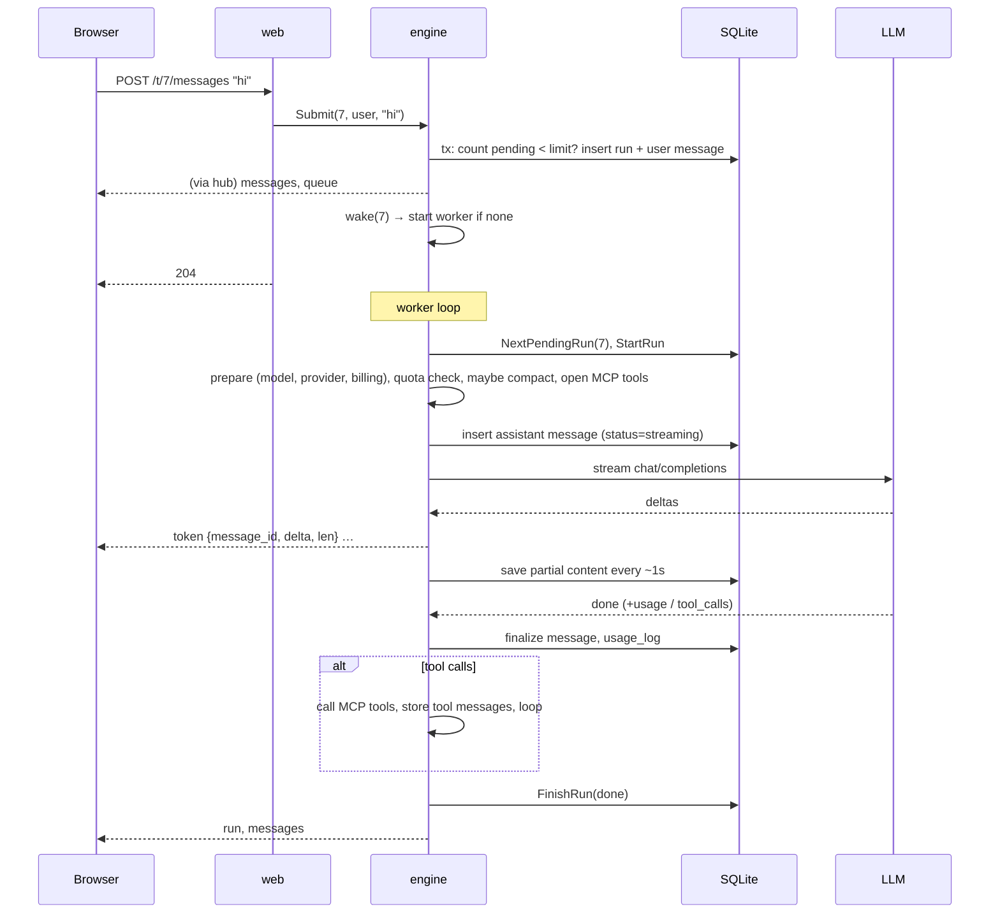

# Knitnox architecture

This document explains how Knitnox works inside and why it is built this way. Read it before changing the engine, the queue or the streaming protocol.

## 1. The core idea

> **Generation belongs to the server, not to the browser request.**

Sending a message only *stores* it and puts it in a queue. A per-thread worker goroutine does the AI work and publishes progress. Browsers are just *viewers* that subscribe to a thread's event stream. Background generation, the queue, multi-tab, reconnect-after-sleep and group chat all follow from this one decision.

```
 Browser A ─┐  POST /t/7/messages        ┌──────────── SQLite ────────────┐
 Browser B ─┤ ─────────────────────────► │ runs(status=pending) + message │
            │  204 immediately           └───────────────┬────────────────┘
            │                                            │ wake(7)
            │                                 ┌──────────▼──────────┐
            │                                 │ worker for thread 7 │  one goroutine per busy thread
            │                                 │  pull next pending  │
            │                                 │  compact if needed  │
            │                                 │  agent loop:        │──► LLM  (OpenAI-compatible, streaming)
            │                                 │   stream → tools →  │──► MCP servers (tools)
            │                                 │   stream → …        │
            │                                 └──────────┬──────────┘
            │        GET /t/7/events (SSE)               │ Publish(7, event)
            └◄──────────────────────────────── hub ◄─────┘
                 token / messages / run / queue
```

## 2. Packages

```
cmd/knitnox ──► web ──► engine ──► llm ──┐   (HTTP client, no DB)
                 │        ├─────► mcp ──┴─► netguard   (which addresses may be called)
                 │        ├─────► hub      (in-memory pub/sub)
                 ├──► files (upload checks, text extraction)
                 └────────┴─────► store ──► secret
```

| Package | Responsibility | Must not |
|---|---|---|
| `store` | Every SQL statement, migrations, encryption of secrets on write and read | know about HTTP or LLMs |
| `secret` | AES-256-GCM seal/open, key file | — |
| `llm` | One streamed `/chat/completions` call → `Result` (content, tool calls, usage), with an idle watchdog; embeddings; pictures, voice and video | retry, bill, or touch the DB |
| `mcp` | Streamable HTTP MCP client: `initialize`, `tools/list`, `tools/call`; says whether a failed call can have reached the tool (`NotSent`) | launch processes |
| `netguard` | The HTTP client for addresses a user typed in; refuses link-local and, when the admin says so, local addresses, at connect time | know who the user is |
| `files` | Decides what an upload is from its bytes; extracts text from PDFs and text files | trust the file name |
| `hub` | `Subscribe(thread)` / `Publish(thread, event)`, non-blocking | buffer forever |
| `engine` | Workers, queue processing, agent loop, retries, compaction, quotas, billing | render HTML |
| `web` | Routing, sessions, CSRF, permissions, templates, SSE endpoint | run LLM calls itself (except the MCP "Test" button) |

## 3. Data model

```
users ─┬─< sessions
       ├─< providers (owner_user_id NULL = global) ─< models
       ├── quotas (1:1)
       ├─< mcp_servers (approval: auto | ask)
       ├─< usage_log
       ├─< push_subscriptions
       ├─< audit_log (as actor)
       └─< thread_members (pinned, archived) >─ threads ─┬─< runs ─< messages ─< attachments (kind, text; files in DATA/uploads)
                                 (kind: chat | group)     │                   └─< tool_approvals
                                                          ├─< thread_invites        (groups only)
                                                          ├─< mcp_servers.group_id  (a group's own tool servers)
                                                          ├── group_settings (1:1)  (a group's embedding model)
                                                          ├─< thread_groups         (groups a personal chat may read)
                                                          └── thread_shares (1:1)   (a personal chat's read-only link)
messages_fts (FTS5 index over messages.content, trigger-maintained)
agents, agent_tasks, agent_mcp, thread_agents, store_agents, … (agents, see §16)
memories, memory_entities, memory_relations, … (long-term memory, see §17)
plan_projects, plan_tasks, plan_log, plan_settings (Plan Book, see §18)
feed_posts, feed_reads, feed_settings (Feed, see §19; files in DATA/feedmedia)
issues (Help → Issues)
settings (key/value, incl. VAPID keys and the state of the last backup)
schema_migrations
```

Key tables:

- **`runs`** are the queue and the history of turns at once. A run is one user turn: `pending → running → done | failed | cancelled | interrupted`. Pending runs *are* the queue; nothing else is needed.
- **`messages`** always belong to a run. Display order is `(run_id, id)`, **not** insertion time. That keeps each answer under its question even when three messages were queued before the first answer started.
- **`threads.summary` + `threads.compacted_until_run`** hold compaction state. Messages are never deleted by compaction.
- **`providers.owner_user_id`**: `NULL` is a shared provider (counts toward quota), a user ID is a personal key (logged, never counted).

All timestamps are UTC text `YYYY-MM-DD HH:MM:SS`, so string comparison equals time comparison.

## 4. The life of a message



## 5. Workers and the queue

`engine.Engine` keeps five maps under one mutex, plus a semaphore:

| Field | Meaning |
|---|---|
| `workers[thread]` | a worker goroutine exists for this thread |
| `active[thread]` | the run currently executing, plus its `cancel` func and a `stopped` flag |
| `live[thread]` | in-memory copy of the message being streamed (content + reasoning, for snapshots) |
| `waiting[thread]` | the thread's next run is waiting for a free slot |
| `approvals[id]` | channel on which a pending tool approval receives its decision |
| `slots` | resizable counting semaphore; the limit (`MaxParallelRuns`) is re-read from settings on every acquire |

**Invariants**
1. At most **one worker per thread**, so at most one running run per thread. That is what makes group chat turn-based.
2. Runs are processed in **id order (FIFO)**.
3. Different threads run **in parallel** (one goroutine each), but at most `MaxParallelRuns` are *generating* at once. A worker acquires a slot **before** `StartRun`, so a run waiting for a slot is still `pending` in the DB: a restart simply re-queues it, and Stop while waiting marks it `cancelled`.

**The lost-wakeup race and how it's avoided.** `Submit` commits the run *before* calling `wake`, and `wake` takes the mutex. A worker that finds no work re-checks the DB **while holding the mutex** before it deregisters itself. So either the worker sees the new run, or it has already deregistered and `wake` starts a fresh one. See `engine.go → work()`.

**Queue limit** is enforced inside the same transaction that inserts the run (`store.EnqueueMessage`), so concurrent senders cannot exceed it.

**Stop** cancels the run's context and marks the run `cancelled`; the partial answer is kept with status `interrupted`. **Cancel queued** deletes a pending run and its message (cascade). Members can cancel their own; the owner can cancel anyone's.

## 6. Streaming protocol (SSE)

Endpoint: `GET /t/{id}/events`. Each event is `data: {"type": …, "data": …}`.

| type | data | client reaction |
|---|---|---|
| `token` | `{message_id, delta, len[, kind:"reasoning"]}` | append if consistent, else resync. `kind: "reasoning"` goes to the Thinking block and has its own running `len` |
| `snapshot` | `{message_id, content, len, reasoning, rlen}` | replace the live text (sent on connect if a reply is streaming) |
| `messages` | — | re-fetch `/t/{id}/messages` (HTML fragment) |
| `run` | `{run_id, status, error}` | re-fetch. `status: "waiting"` is UI-only (waiting for a slot) |
| `queue` | `{pending}` | update "3 queued" |
| `compacted` | `{until_run}` | re-fetch (shows the memory box) |
| `approval` | `{id, tool, server}` | re-fetch (shows the Allow/Deny card); mark the tab title when hidden |

**Why `len`?** It is the total length of the streamed text after this delta, in **UTF-16 code units** (what JS `string.length` counts). The client keeps `live[message_id]`:

- `len <= current.length`: a duplicate, already covered by the snapshot. Ignore it.
- `current.length + delta.length == len`: append.
- anything else means events were dropped (the hub drops for slow clients). **Resync** by reconnecting, which delivers a fresh `snapshot`.

The SSE handler **subscribes before it sends the snapshot**, so nothing falls in the gap between them.

**Reloading the page** renders whatever the DB has (saved at most ~1s stale), and the snapshot then fills in the rest. The client never lets a lagging DB copy overwrite longer live text.

The hub is deliberately lossy (`select … default`). A stuck browser can never block a worker; correctness comes from the resync rules above.

## 7. The agent loop

`engine/run.go → execute()`:

```
prepare        → thread, members, model, provider, who pays
quota check    (billable only)
auto-title     (first message → thread title)
maybeCompact   (failure is logged, not fatal)
openTools      (parallel connect, 15s timeout each; broken servers are skipped)
buildContext   → [system] [summary?] [history after summary] [this run's messages]

for step = 1..∞:
    final = step > AgentMaxSteps
    quota check (billable, step > 1)
    streamStep(msgs, tools unless final)   ← retries 429/5xx/network ≤ LLMMaxRetries,
                                             only if no token was received yet;
                                             given up after LLMIdleSeconds of silence
    no tool calls or final → done
    for each tool call: if the server is in "ask" mode → awaitApproval (see §15)
                        allowed → call MCP (repeated ≤ ToolMaxRetries, but only when
                                  the call cannot have reached the tool, see §20)
                        denied / expired → a fixed explanation becomes the tool result
                        store tool message, append to msgs
```

- **Pair counting ≠ step counting.** A turn with 6 tool steps is still **one** pair for compaction.
- At the step limit, one last call is made **without tools**, with a system note asking the model to answer with what it has. The user always gets an answer, never a dangling tool call.
- Tool output is capped at 20,000 characters. Tool-level errors (`isError`) go back to the model instead of being retried, because the model can often fix its arguments.
- Tool names are exposed as `s{serverID}_{tool}` so two servers can both have a `search` tool.
- **History** sent to the model includes past user messages and final assistant answers only. Past tool traffic is dropped, which saves tokens and avoids provider errors about orphaned tool calls. The current turn includes everything.

## 8. Compaction

`engine/compact.go → maybeCompact()` runs inside the worker *before* the turn, so it never races with generation.

```
pairs  = finished runs with id > compacted_until_run (and < current run)
if pairs <= keep:                     nothing to fold
trigger if pairs > CompactionPairs (50)
     or estimated_tokens(summary + history) > ratio (0.7) × model.context_window
cut    = id of the run just before the last `keep` (10) pairs
new_summary = LLM(existing summary + transcript of runs (compacted_until_run, cut])
threads.summary = new_summary; threads.compacted_until_run = cut
```

- **Rolling.** Each compaction merges the previous summary with the next chunk, so the cost per compaction stays bounded.
- The token estimate is chars/4. It is cheap and good enough for a safety trigger.
- Compaction usage is logged as `kind = 'compaction'` and charged to the **thread owner**.
- The UI shows a "memory" box with the current summary; the full history stays visible.

## 9. Billing and quotas

| Model's provider | Who may use it | Charged to | Counts toward quota |
|---|---|---|---|
| Shared (admin) | everyone | message author | **yes** |
| Personal, author is its owner | owner | owner | no (logged only) |
| Personal, chosen by a group's admin for that group | every member of the group | the admin's key; usage row records the author | no |

- Quota = billable `prompt + completion` tokens since the start of the current UTC day or month. `0` = unlimited.
- Checked before the turn and before every further agent step, so a long tool loop cannot overrun by much.
- When a provider sends no `usage`, the call is estimated (chars/4) and flagged `estimated = 1`.
- Cost = tokens × per-model price (USD per 1M), set by whoever added the model.

## 10. Groups and read-only links

> **A chat is one of two kinds, for good.** `threads.kind` is `chat` or `group`. It is set when the chat is made and no code changes it afterwards.

Before migration 015 a chat "became" a group chat when a second person joined and turned back when the last one left. Three problems came from that one rule: sharing a chat showed its new members everything the owner's personal tools had answered in it; the tool list, which sits at the start of the prompt, changed with membership, so the provider's cache was thrown away; and "whose tools?" had no good answer. A fixed kind removes all three.

| | Personal chat (`chat`) | Group (`group`) |
|---|---|---|
| Who writes | its owner only | everyone who joined by invite (members), plus viewers who only read |
| Tools | the owner's memory, Plan Book, feed, pictures, agents and tool servers | only what belongs to the group: its memory and its tool servers |
| Memory | the owner's (`MemOwner{UserID}`) | the group's own (`MemOwner{UserID: owner, GroupID: thread}`), written only by the AI |
| Tool servers | the owner's shared ones (`group_id IS NULL`, `agent_id IS NULL`) | rows with `mcp_servers.group_id = thread` |
| Model | the owner's choice | one for everybody, chosen by the admin (the owner) |
| Others can… | read it through a read-only link | join with an invite link |
| Clock | the owner's time zone | the server's |

The code is in `store/groups.go`, `engine/groups.go`, `web/groups.go`, `templates/group.html` and `templates/shared.html`; the schema is `migrations/015_groups.sql`. An agent's thread is a `chat`.

### Groups

**Roles**: `owner` (shown as *admin*: settings, model, invites, tool servers, remove members, cancel any queued message, delete the group), `member` (chat, cancel own queued messages), `viewer` (read only).

**Turn-based** means one shared FIFO queue, answered one at a time. Each user message reaches the model as `[username]: text`, and the system prompt lists the participants. This is so from the first message, also while the admin is still alone in the group.

**What `openTools` does for a group**: it connects the group's own enabled tool servers, adds the memory tools for `GroupMemory(thread)` unless the admin switched *Group memory* off, and returns. Nothing after that line runs, so no personal tool can be added to a group by accident. The same toolset is built whoever wrote the message, which is why the prompt prefix is identical between members (`TestGroupHasItsOwnMemory` checks it).

**Group memory** is the memory of §17 with a second kind of owner. The differences:

| | A person's memory | A group's memory |
|---|---|---|
| Who writes | the person on the Memory page, and the AI | the AI only, with the same tools (`memory_save`, …) |
| Who reads | the person | every member, on `/t/{id}/memory` |
| Who deletes | the person | the admin any fact; a member the facts from their own messages (`memories.said_by`) |
| Pinned memories in the prompt | up to 12 | none: the note is a constant, so the prefix never changes |
| Embedding model | the person's or the server's | the admin's choice in `group_settings` (a shared model or one of the admin's own), else the server's |

People cannot add or edit a fact. That is deliberate: a fact typed in by one member would shape the answers for all of them.

**Tool servers of a group** work like an agent's own servers (§16): a row in `mcp_servers` with `group_id` set. `ListMCPServers` filters them out of the owner's personal list, and `ThreadMCPServers` returns either the owner's or the group's, never both. They are kept under the owner's `user_id`, so the existing owner checks (`MCPServerByID`, test, approval mode) apply unchanged.

**Keys**: a group may run on one of the admin's own models. Then `prepare` lets every member's run use that personal provider, and nothing counts toward anybody's quota. In every other case a personal key is used only by its owner.

**Invites**: random 128-bit token, expiry (1–90 days), max uses, revocable. `CreateInvite` and `AcceptInvite` both check `kind = 'group'`, so a personal chat cannot be joined even with an old token. A removed member's open SSE stream is closed at the next 20-second ping. New members read the whole history.

### Looking into a group from a personal chat

A group cannot post to anybody's feed. The bridge is a **reference**: a row in `thread_groups(thread_id, group_id)` lets a personal chat read a group its owner is in.

| Step | Where |
|---|---|
| Connect | the Tools menu (rows keyed `group:<id>`, `web/tools.go → groupRows`), or "Take to my chat" under a group message, which opens the home screen with the group ticked and the message quoted (`takenFromGroup`) |
| Who may | `store.SetThreadGroup`: the chat is a personal chat of the user, not an agent's; the target is a group; the user is a member of it |
| Tools | `engine.addGroupTools`: `group_memory_search`, `group_memory_read`, `group_messages` (up to 30 turns, text only, capped at 12,000 characters, oldest left out first). None of them writes |
| Prompt | `groupRefsNote` names the connected groups and nothing else. Group text reaches the model only as tool answers |

Two rules:

1. **Membership is checked on every call** (`ThreadGroups` computes `Member` each time). A person who leaves or is removed keeps the reference, so the prompt prefix does not change, but every tool answers that the group can no longer be read. Deleting the group removes the reference (`ON DELETE CASCADE`).
2. **Group text is data.** Every answer says so, the way memory answers do. This matters more here than anywhere else: the personal chat has its owner's feed, memory and tool servers, and the text it reads was written by other people.

### Read-only links

`thread_shares(thread_id, token, until_run, show_tools)` is the one link a personal chat can have. `GET /s/{token}` is the only chat page that needs no account.

| Rule | How |
|---|---|
| A copy in time | The page shows runs up to `until_run`, the newest finished run when the link was made. "Update the link to now" moves it; the token stays |
| Tools hidden by default | Without `show_tools` only user and assistant messages are loaded, and assistant steps that only called tools are skipped |
| Files | `/s/{token}/files/{id}` serves an attachment only if its message is inside the copy. Recordings (Read aloud) are never served |
| Nothing to send | The page has no form, no CSRF token and no sidebar; it is marked `noindex` and `no-store` |
| Stopping | `DELETE` of the row. An unknown and a stopped link answer the same 404 |
| Server switch | `settings.share_links` (Admin → Settings). Off: no link can be made and none works |

Groups and agents have no link: `SaveShare` inserts only for `kind = 'chat'` threads that are not an agent's.

### Chats from before

Migration 015 turns every chat with more than one member into a group, copies the owner's tool servers that were ticked for it into group servers (the encrypted headers are copied as they are), deletes invites to chats that stay personal, and sets `threads.group_notice`. The owner then sees one note on the chat: earlier messages may hold answers of their personal tools, and the members can still read them. `POST /t/{id}/notice` clears it. `thread_mcp` and `threads.allow_owner_key` are no longer read.

### Trade-offs

| Decision | Why | Cost / when to revisit |
|---|---|---|
| The kind never changes | no leak at the moment of sharing, a stable prompt prefix, one rule to explain | a chat cannot be "opened up" later; people start a group and take what they need with them |
| No personal tools in a group, not even the admin's | every member can make the AI use whatever is there | "post what we decided" takes one more step (Take to my chat) |
| Only the AI writes the group's memory | nobody can plant a fact by typing it | a wrong fact is fixed by asking the AI in the group, or deleted |
| A reference reads through tools | nothing from the group enters the prompt; the cache of the personal chat is kept | the model has to decide to look; it is told when in `groupRefsNote` |
| The link is a copy in time | tomorrow's memory search is not published by a link made today | the owner has to update the link to show more |
| The memory tables keep `user_id` and add `group_id` | no change for personal memory; a group's rows go when its owner's account goes | every memory query filters on two columns (`MemOwner`) |

### What a person sees of the AI's work

`users.show_thinking` (default on) and `users.show_tools` (default off) are display choices of the viewer, set under Settings → Appearance. They never change what is stored or what the model is sent, so they cost nothing in tokens or cache, and two people in one group can see the same run differently.

With `show_tools` off, `viewMessages` draws nothing for tool messages and for assistant steps that only called tools, and puts all of a run's calls and answers (`toolSteps`) into one folded line before the run's last message. Kept visible in every case: a pending approval card, pictures a tool made, a count of calls that failed, and "Using …" while a run waits for a tool. Agent threads ignore both switches, because an agent's page is its log. A read-only link does not use them either: there the chat's owner decides.

## 11. Failure and recovery

| Situation | Result |
|---|---|
| Browser closes / laptop sleeps | Nothing happens to the run. On return the page shows the DB state, and SSE resumes with a snapshot |
| Provider 429/5xx before first token | Retried up to `LLMMaxRetries` times, waiting max(backoff 1s/2s/4s…, the provider's `Retry-After`), capped at 60s |
| All slots busy | The run stays `pending` and the chat shows "Waiting for a free slot…" until another run finishes |
| Nobody answers a tool approval | After `ApprovalTimeoutMin` the call is treated as denied and the model is told so; the run continues |
| Provider fails mid-stream | Run `failed`; partial text kept (status `failed`) |
| Provider goes silent (before or during an answer) | After `LLMIdleSeconds` (300) the call ends with `llm.ErrStalled`; run `failed`, partial text kept, slot given back. Not retried automatically |
| Connection closes before the provider said it was done | `llm.ErrTruncated`; run `failed`, partial text kept. A half answer is never stored as a whole one |
| A run goes on for too long | After `RunMaxMinutes` (60), counted from when it got its slot, the run is cancelled and marked `failed` |
| A panic inside a run, a hook, the scheduler or a background job | Caught (§20): the run is marked `failed`, the stack is logged, the server keeps running |
| MCP server down at turn start | Skipped (logged); chat continues without its tools |
| MCP call could not be delivered (connection refused, 429, 503) | Retried `ToolMaxRetries` times, then the error text goes to the model |
| MCP call was sent but no answer came (timeout, dropped connection, 5xx) | **Not** retried: the tool may have run. The model is told so and asked to check before repeating anything with side effects |
| User presses Stop | Run `cancelled`, partial text kept |
| Graceful shutdown (SIGINT/SIGTERM) | Running runs are cancelled and become `interrupted`; HTTP drains (10s) |
| Crash / kill -9 | On startup `RecoverAfterRestart` marks `running` runs `interrupted`, streaming messages `interrupted` and pending tool approvals `expired`, then **restarts workers for every thread with pending runs** |

Interrupted turns are not re-run automatically, because tools may have side effects. The user can resend.

## 12. Frontend

- **Server-rendered HTML** (`html/template`). Every page is `layout.html + partials.html + page.html`.
- **htmx** for the admin and settings CRUD. Handlers return the re-rendered fragment (`#providers`, `#users`, `#mcp`, `#panel`). The main create forms also carry `action`/`method`, so they still work without htmx (POST + redirect). Small action buttons (toggle, delete) need htmx, which is vendored and served locally.
- **`app.js`** (vanilla) handles the chat view (SSE, token appending for content and reasoning, coalesced list refresh, "load earlier" paging, the composer with image/file attachments, Stop, Cancel, edit, approvals), the chat-list menus (rename inline, pin, archive, delete, leave), keyboard shortcuts, service-worker registration and push subscription.
- **Paging**: the first render shows the newest 200 messages. "Load earlier" fetches `?before=<oldest run>` and prepends it, keeping the scroll position. After that, every refresh asks for `?from=<oldest loaded run>` so loaded history is never lost (capped at 3000 messages).
- **No inline styles** (CSP `style-src 'self'`): meters carry `data-pct` and get their width from JS; markdown output has `style` attributes stripped.
- **Markdown**: the server outputs the raw text HTML-escaped, and the client renders it with `marked` and sanitises it with `DOMPurify`. A picture whose address is on another site is not loaded: a DOMPurify hook moves its `src` aside and `renderMD` puts a "Show picture from …" button in its place (§20). Each `<pre>` is then wrapped with a language label and a Copy button, and highlighted by `highlight.js` (labelled fences only; the colours are monochrome CSS in `style.css`). User messages are shown as plain text.
- **Mobile**: below 760px the sidebar becomes an off-canvas drawer (`body.sidebar-open`) and the panel becomes a full-screen sheet. On touch devices Enter inserts a new line and messages are sent with the button.
- No inline scripts (CSP `script-src 'self'`). The CSRF token comes from `<body data-csrf>` and htmx sends it through `hx-headers`.

## 13. Scaling and trade-offs

| Decision | Why | Cost / when to revisit |
|---|---|---|
| SQLite (WAL, `busy_timeout`, `_txlock=immediate`) | zero ops, one file, plenty for hundreds of users | very high write rates → Postgres (only `store` changes) |
| In-memory hub and workers | simple, no broker | **single instance**. For several instances: a per-thread lease in the DB (claim runs with `UPDATE … WHERE status='pending'`) and Redis or Postgres `LISTEN/NOTIFY` for the hub |
| Re-fetch the message list on structural events | trivially correct | long chats re-render the loaded messages (200 at first); switch to per-message fragments if needed |
| Own MCP and LLM clients (~300 lines each) | no SDK churn, easy to read | new MCP features (resources, prompts, OAuth) must be added by hand |
| Partial saves every ~1s | reload shows progress without a write per token | up to 1s of text is recovered from the live snapshot instead of the DB |
| Interrupted runs are not auto-retried | tools may have side effects | the author presses **Retry** under the turn |

## 14. Edits, regeneration and images

**Edit / regenerate / retry** all go through one endpoint, `POST /t/{id}/runs/{rid}/edit` (`content=…` or `regenerate=1`), and one engine method, `Engine.Edit`:

| Run state | What happens |
|---|---|
| `pending` (queued) | The user message text is replaced in place. Nothing else changes. |
| finished, and it is the **latest run in the thread** | `ResetRun`: the run's assistant and tool messages are deleted, the user message is updated (`edited = 1`), and the run goes back to `pending` **with the same id**, so it keeps its place in the order. Then `wake()`. |
| running (latest) | `Stop()`, wait until the worker lets go of it, then reset as above. |
| older than the latest run | Refused (`ErrNotLatest`, HTTP 409). Rewriting the middle of a conversation would make later answers inconsistent, especially in group chats. |

Only the run's author can edit it. Tokens already spent stay in `usage_log`. In the UI, a list refresh is **paused while an edit box is open**, so live events never wipe what the user is typing.

**Images**

```
browser: pick / paste / drop → resize to ≤2048px (canvas) → FormData(images[])
server:  MaxBytesReader(48MB) → ≤6 files, ≤10MB each → sniff bytes (png/jpeg/webp/gif)
         → DATA/uploads/<random>.<ext> → attachments row linked to the user message
engine:  buildContext loads attachments; for vision models, images of the current
         turn and the previous 3 are inlined as data: URLs (OpenAI content parts);
         older ones and text-only models get "[N image(s) were attached here]"
```

- `llm.Message.MarshalJSON` switches `content` from a string to `[{type:text},{type:image_url}]` only when images are present, so text-only requests are unchanged.
- `GET /files/{id}` serves a file only to members of its chat (`Cache-Control: private, immutable`). The stored MIME type comes from sniffing, never from the client.
- Each model has a `vision` flag, guessed from the model's name when it is added (`GuessVision`) and changeable in the providers list. Documents can be attached to every model; images sent to a text-only model are rejected by the server.
- File cleanup: deleting a chat removes its files immediately. Anything else (deleted users, cancelled queued messages) is caught by the hourly orphan sweep (`SweepOrphanUploads`, files older than 1 hour that no row references).

## 15. Tool approval, capacity, files and the rest

### Tool approval ("Ask before running")

Each MCP server has `approval = auto | ask`. In `openTools` every tool route remembers its server's mode. When the model calls a tool on an "ask" server, `awaitApproval`:

1. inserts a `tool_approvals` row (`pending`) linked to the assistant message that made the call,
2. registers a buffered channel in `engine.approvals[id]`,
3. publishes `messages` + `approval` events (the card appears for everyone; only approvers get buttons) and calls the `OnApproval` hook (push notification to the run author and the chat owner if they are not watching the chat),
4. blocks on `select { decision channel, timeout, ctx.Done() }`.

`POST /t/{id}/approvals/{aid}` (`decision = allow | deny | always`) is allowed for the **run author or the chat owner** (viewers never). `DecideApproval` is a conditional `UPDATE … WHERE status='pending'`, so a second decision is refused (409) and the first one wins even under races. `always` additionally sets the server to `auto` and is owner-only, because the server belongs to the owner. The worker then runs the tool, or feeds the model a fixed sentence ("The user did not allow this tool call…") so the model can explain and continue. Stop while waiting cancels the context and marks the approval `expired`; a restart expires all pending approvals (the run is `interrupted` anyway).

Why block the thread's queue? Because the next queued message may depend on the tool's outcome, and running it first would break the turn order that group chats rely on.

### Capacity: the slot semaphore

`engine/slots.go` is a counting semaphore whose limit is a function (`LoadSettings().MaxParallelRuns`), evaluated on every acquire, so admins can change it at runtime. `release` closes-and-replaces a channel to wake every waiter; fairness is not guaranteed, which is fine for a handful of waiters. `Engine.RunningCount()` feeds the admin usage page.

### Custom instructions

`SystemPrompt(global, thread, ownerInstr, members, loc)` in `engine/run.go` builds the system message: global prompt → how to read the time stamps (no date or time itself, see below) → the **thread owner's personal instructions (solo chats only)** → the **thread's instructions** → group guidance. Personal instructions are left out of group chats on purpose: they are private, and mixing several people's instructions would make the AI inconsistent. The same function powers the context meter so the estimate matches what is sent.

### Date and time

Models have no clock, so every run is told the date and time of the person it works for (`engine/clock.go`). `users.timezone` holds an IANA name; `app.js` posts the device's zone to `POST /settings/timezone` whenever it differs, unless the user fixed it by hand (`timezone_auto = 0`). Unknown means UTC. Zone data is compiled in (`time/tzdata`), so it also works on Windows.

- **Every user message is stamped.** Its text for the model starts with a line like `[Wed, 11 Nov 2026, 19:05]`: the time it was sent. Earlier messages use their stored `created_at`; the turn being answered uses the time right now. The newest stamp is "now".
- **The system prompt holds no date or time.** It only explains the stamps and names the zone. Together with stamps that never change, this keeps the start of the prompt byte-for-byte identical from turn to turn, which is what provider-side prompt caching needs. A clock in the system prompt would discard the cache every minute.
- **Group chats use the server's clock** (`time.Local`), because members may be in different zones.
- **Agents:** date and time in the agent prompt, in the owner's zone. Agent runs start fresh, so there is no cache to protect.

> **Keep the prompt prefix stable.** Anything added to the system prompt or to earlier messages must not change between turns. The known exception is attachments: an image is sent in full for 3 turns and a file for 6, then replaced by a short note, which changes that message once.

### Files

```
browser: pick / paste / drop → images resized ≤2048px → FormData(files[])
server:  MaxBytesReader(48MB) → ≤6 files → files.Classify(bytes, name):
           sniff (never trust the name) → image | pdf → text (ledongthuc/pdf) | text-like → text
           → DATA/uploads/<random>.<ext> + attachments(kind, text ≤120k chars)
engine:  images → data: URL parts (vision models, current + 3 previous turns)
         documents → "<attached_file name=…>text</attached_file>" appended to the user
                     message (current + 6 previous turns); older → "[file attached earlier: …]"
```

Documents are served with `Content-Disposition: attachment`, and HTML/XML as `text/plain`, so nothing a user uploads can execute in Knitnox's origin.

### Search

`messages_fts` is an FTS5 external-content table over `messages.content`, kept in sync by three triggers. Queries are built by `ftsQuery`: every word becomes a quoted prefix term (`"word"*`), so user input can never inject FTS operators. Results are joined with `thread_members` for the searching user, so you only ever see chats you belong to. `snippet()` marks hits with `[[ ]]`, which the handler turns into `<mark>` after HTML-escaping.

### Notifications (PWA + Web Push)

`/manifest.webmanifest` and `/sw.js` are served from the root so the service worker controls every page. The worker only touches `/static/*` (network-first, cache as an offline fallback) and shows push notifications; chat pages are never cached. Asset URLs carry `?v=<hash of all embedded static files>` (`staticVersion()` at startup, the `asset` template func), so every build gets fresh CSS/JS and versioned URLs can be cached for a year. VAPID keys are generated once (`webpush.GenerateVAPIDKeys`) and stored in `settings`. Subscriptions live in `push_subscriptions`. The web layer tracks who has an open SSE stream per thread (`watchers`); `OnRunFinished` and `OnApproval` only notify users who are **not** currently watching that chat. Push services answering 404/410 delete the subscription.

### Login limiter and audit

`web/limiter.go` counts failed logins under three keys in a 15-minute window and locks a key for 15 minutes when its limit is reached:

| Key | Limit | Stops |
|---|---|---|
| `user:<name>\|<addr>` | 10 | one address guessing one account |
| `ip:<addr>` | 30 | one address trying many accounts |
| `name:<name>` | 100 | many addresses guessing one account |

Counting per name *and* address is what keeps a stranger from locking a known account out by failing on purpose. A successful login resets the first and third key. An unknown name is compared against a dummy hash, so it takes as long as a wrong password, and "this account is disabled" is said only after the right password. Sign-ups are counted the same way (`signup:<addr>`, 10). `X-Forwarded-For` is honoured only from loopback, and then only its **last** entry, the one the local proxy added.

`store.Audit` is called from every admin mutation with actor, action, target and details; failures to write an audit row never block the action.

### Organising chats

`thread_members.pinned / archived` are **per member**, so two people in the same group can pin or archive it independently. The sidebar is grouped Pinned → Groups → Today → Yesterday → … with archived chats in a collapsed group; the "⋯" menu on every row (and in the chat's top bar) offers rename (owner), pin, archive, export and delete (owner) / leave (member). Rename is `POST /t/{id}/rename` and is edited inline in the sidebar.

## 16. Agents and the agent store

An **agent** is a saved background worker: a job description, a set of MCP tools and a to-do list. The code is in `store/agents.go`, `engine/agents.go` and `web/agents.go`; the schema is `migrations/004_agents.sql`.

> **An agent is a thread plus a row in `agents`.** Each run of the agent is an ordinary run in that thread.

That one decision means the queue, the worker, streaming, Stop, tool approvals, quotas, billing and push notifications all apply to agents with no extra code. The agent's page is the normal chat page (`/t/{thread}`) with an agent panel in place of the share panel. Agent threads are left out of the sidebar's chat list.

```
agents ──1:1── threads ─< runs ─< messages          (the agent's log and control chat)
   ├─< agent_mcp >─ mcp_servers                       (tools = '' → all, else an allowlist)
   ├─< agent_tasks (source_thread_id → the chat that asked)
   ├─< agent_notes_log
   └─< thread_agents >─ threads                       (chats that may manage this agent)
store_agents (source_agent_id → agents)               (shared configurations)
```

### What is different about an agent run

`prepare` looks up `AgentByThread`. When it finds one, `execute` changes three things:

| | Chat turn | Agent run |
|---|---|---|
| Context | system prompt, summary, history, this turn | `AgentSystemPrompt` + **only this run's messages**. No history, no compaction |
| Tools | the thread's MCP servers, plus manager tools if agents are connected | the servers and tools ticked for the agent, plus `list_tasks`, `update_task`, `add_task`, `save_memory` |
| Step limit | `AgentMaxSteps` (admin setting) | `agents.max_steps` |

`AgentSystemPrompt` contains the instructions, the notes, the agent's memory, up to 30 open tasks and a one-line digest of its last 3 runs. That digest and the memory are the only things carried from one run to the next.

An agent's text is split by who may change it:

- **`instructions`**: the core job. Only the owner, in the UI.
- **`notes`**: adjustments. The owner, or a connected chat's AI through `update_agent_notes`. Every change is kept in `agent_notes_log` and shown in the panel.
- **`memory`**: written by the agent itself with `save_memory`. The owner can clear it.

Tools are chosen by the owner only.

### What starts a run

| Trigger | Path | Limits applied |
|---|---|---|
| Owner types in the agent's chat | `Engine.Submit`, like any message | queue limit |
| Owner presses **Run now** | `Engine.RunAgent` | refused while a run is queued or running |
| Schedule | `Engine.RunDueAgents`, every 30 s | paused, busy, daily cap, "only with open tasks", owner disabled |
| A connected chat (`run_agent`, or `create_agent_task` with `run_now`) | `Engine.triggerAgent` | paused, busy, daily cap, owner disabled |

The scheduler moves `next_run_at` forward **before** it tries to start the agent, so a skipped or failed start is not retried every tick. `next_run_at` lives in the database, so a restart loses nothing. Every run is authored by the agent's owner, which is who pays and who approves "ask first" tools.

### Manager and workers

Agents never talk to each other. The only manager is a chat's AI, and only for agents the **chat owner** connected to that chat (`thread_agents`, set in the chat's Share panel). `ConnectedAgents` repeats the ownership check on every turn.

A connected chat gets built-in tools: `list_agents`, `list_agent_tasks`, `create_agent_task`, `update_agent_task`, `read_agent_runs`, `read_agent_run`, `run_agent`, `update_agent_notes`. They take an `agent` id, so connecting more agents does not add more tools. Built-in tools live in `toolset.local` and never ask for approval; MCP tools keep their server's mode.

- **Never waits.** Starting an agent only queues a run. When the agent sets a task to `done` or `failed`, `reportTask` posts the result into the chat that created it (`store.InsertNote`: a finished run with one AI message, no turn started there).
- **Limited reading.** `read_agent_runs` returns at most `agents.history_runs` run summaries (trigger and final answer, truncated). `read_agent_run` opens one run in full.
- **Untrusted text.** What an agent wrote may contain text from web pages or email. Tool output that carries it starts with a note saying it is data, not instructions.
- **Limited writing.** A chat can create tasks, edit or cancel open ones, and change the notes. It cannot change instructions, tools, the schedule or the limits.

### Agent store

Publishing copies the name, instructions, schedule and limits into `store_agents`, with a description, a guide and a free-text list of the tools needed. Tasks, memory, notes, runs and MCP servers (URLs and headers) are never copied. Installing creates the user's own agent, **paused** and without tools: they pick a model and their own MCP servers, then switch it on. The author can update or remove a listing; an admin can remove any listing (audited). Removing a listing does not affect installed copies.

### Trade-offs

| Decision | Why | Cost / when to revisit |
|---|---|---|
| Agent = thread | reuses the whole engine and chat UI | an agent's log is one long thread; housekeeping keeps the newest 300 runs per agent (§20) |
| No history between runs | cost stays flat and behaviour is predictable | the agent must use tasks and memory to remember things |
| Hub-and-spoke only | no loops, no chain depth, no privilege hand-offs between agents | no multi-agent pipelines; add them with a depth limit if ever needed |
| Result posted as an AI message in the asking chat | the user and the chat's model both see it without a new turn | the asking chat's latest turn can no longer be edited or regenerated once a result arrives after it |
| Tool allowlist typed as names | no live connection needed to edit an agent | a typo silently hides a tool; "Show tools" lists the real names |

### An agent's own MCP servers

`mcp_servers.agent_id` (migration 005) marks a server as belonging to one agent. `NULL` is a normal, shared server of the user.

| Server | Listed on Settings | Used by the owner's chats | Used by an agent |
|---|---|---|---|
| Shared (`agent_id` and `group_id` NULL) | yes | yes, all enabled ones (personal chats only) | only if ticked for it, filtered by its allowlist |
| Own (`agent_id` set) | no | never | that agent only, every tool |
| A group's (`group_id` set, §10) | no (in the group's panel) | in that group only | never |

`ListMCPServers`, `ThreadMCPServers` and `SetAgentMCP` all filter on `agent_id IS NULL`, so an own server cannot be ticked for a chat or for another agent. `AgentMCPServers` returns the union. Own servers are managed in the agent's panel, are deleted with the agent, and are never copied to the store.

### Connecting from a chat

The chat's top bar has an **Agents** menu (owner only) listing the owner's agents; one click calls `POST /t/{id}/agents/{aid}` (`ToggleThreadAgent`). The same choice is in the Share panel under "Connected agents". The home screen's composer has an **Agents** picker too: `POST /t` reads the ticked `agent` values and calls `SetThreadAgents` **before** `Submit`, so the first turn already has the manager tools. After that the user talks to the chat as usual; the model sees the connected agents in its system prompt and uses the manager tools.

## 17. Long-term memory

**Memory** is a store of short facts that the AI saves in one chat and looks up in another. Every person has one; every group has a separate one of its own (§10). The code is in `store/memory.go`, `engine/memory.go`, `llm/embed.go` and `web/memory.go`; the schema is `migrations/007_memory.sql`.

> **A graph in plain SQLite.** Facts, the things they mention and the connections between those things are four ordinary tables. There is no graph database and no vector extension, so Knitnox stays one pure-Go binary with one database file.

```
memories (content, source, pinned, embedding BLOB, embed_key)
   ├─< memory_mentions >─ memory_entities (name, name_key UNIQUE per user)
   ├─< memory_relations (subject_id, predicate, object_id → memory_entities)
   └── memories_fts (content, about)                  word search
memory_settings (per user: enabled, own embedding provider + model)
agents.use_memory                                      an agent may read its owner's memory
```

Every row carries `user_id` and `group_id` (0 = a person's own memory), and every query filters on both through `store.MemOwner`: `UserMemory(id)` or `GroupMemory(thread)`. So a group's memory cannot be reached with a person's owner value, nor the other way round. A thing (`memory_entities`) exists only while a memory mentions it; `name_key` is the lower-cased name, so "Sam" and "sam" are one thing. Renaming a thing to an existing name merges the two.

### Who gets memory

| Run | Memory tools |
|---|---|
| Personal chat, owner turned memory on | read and write, for the owner's memory |
| Group | read and write, for the group's own memory; never a person's |
| Agent with `use_memory` and owner's memory on | read only |
| Anything else | none |

The decision is made in `openTools`. When tools are added, `execute` appends `memoryNote` to the system prompt: how to use the tools, plus up to 12 pinned memories.

### Tools and the context budget

| Tool | Returns |
|---|---|
| `memory_search` | up to 8 hits, each an id and a 240-character snippet |
| `memory_read` | up to 5 memories in full |
| `memory_explore` | one thing: 20 connections per call (with `offset`) and its 5 newest memories |
| `memory_save`, `memory_update`, `memory_delete` | one line |

A large memory cannot flood the model: lists are capped, full text is fetched by id, the graph is walked one hop per call, and every answer is cut at 6,000 characters. Tool answers say that memory text is data, not instructions.

### Search

1. **Words.** `SearchMemoryText` runs an FTS5 query that matches *any* word of the question (common words are dropped) over the text and the names of the things it is about, ranked by BM25.
2. **Meaning**, only when an embedding model is configured. The question is embedded and compared with every vector of that user that carries the same `embed_key`. Vectors are stored unit-length, so the comparison is a dot product in Go. Only hits within 75% of the best score are kept.
3. **Merge.** The two ranked lists are combined with reciprocal rank fusion.

If the embedding call fails, search logs a warning and returns the word results.

### Embeddings

`MemoryEmbedder` picks the user's own provider and model if set and still theirs, else the admin's (`settings`: `embed_provider_id`, `embed_model`, `embed_dimensions`), else none. `embed_key` is `provider/model/dimensions`; vectors made by another model are ignored and replaced. Saving or editing a memory starts `IndexMemoriesSoon`, one background run per user that embeds whatever is missing in batches of 32. Editing a memory's text clears its vector.

### Trade-offs

| Decision | Why | Cost / when to revisit |
|---|---|---|
| SQLite tables, not a graph database | one file, pure Go, one-hop queries are index lookups | no deep path queries; add them behind the store functions if ever needed |
| Vectors scanned in Go | no extension, exact results | time and memory grow with a user's memories; add an HNSW index past tens of thousands |
| Vectors loaded from the database per search | no cache to keep correct | more disk reads; cache per user if search gets slow |
| Off by default, per user | the AI storing personal facts should be a choice | users must find the switch; the page explains it |
| A person's memory never in a group | one person's memory must not reach others | a group has its own memory instead (§10) |
| Agents read only | agents process untrusted text and could store planted "facts" | an agent cannot learn into the user's memory |
| Memory tools run without approval | saving a note should not interrupt a chat | the AI can change memory; every call is visible in the chat and on the Memory page |
| Embedding calls are not billed | they are small | not counted in quotas or the usage page |

## 18. Plan Book

The **Plan Book** is a per-user list of tasks grouped in projects. The person, the AI in their chats and their agents all work on the same rows. The code is in `store/planbook.go`, `engine/planbook.go` and `web/planbook.go`; the schema is `migrations/009_planbook.sql`. It follows the same module pattern as memory: tables, built-in tools, a page, and a per-user switch.

```
plan_projects (name, name_key UNIQUE per user, notes)
   └─< plan_tasks (title, notes, status, due_date, created_by, actor_name,
   │               source_thread_id, done_at, deleted_at)
   │        └─< plan_log (actor, actor_name, action)
plan_settings (per user: enabled)
agents.plan_access                                    none | read | write
```

| Rule | How |
|---|---|
| A task belongs to one user | every query filters on `user_id`; a project id is checked for ownership before use |
| Due dates are calendar days | `due_date` is `YYYY-MM-DD` in the owner's time zone; "today" is computed with `users.timezone` |
| Deleting is undoable | `deleted_at` marks the bin; the hourly janitor removes rows older than 30 days |
| Every change has an author | `store.PlanActor` (user, ai, agent + name) is passed to each write and recorded in `plan_log` |
| Deleting a project loses nothing | its open and done tasks go to the bin first |

### Who gets the tools

| Run | Tools |
|---|---|
| Solo chat, owner turned the Plan Book on | all six |
| Group chat | none |
| Agent with `plan_access = read` and owner's switch on | `plan_list`, `plan_read`, `plan_projects` |
| Agent with `plan_access = write` and owner's switch on | all six, recorded under the agent's name |

`plan_list` returns one line per task (15 by default, 30 at most, with `offset`); `plan_read` returns one task with notes and its last 5 changes. `planNote` explains the tools in the system prompt and deliberately lists no tasks: task data in the prompt would change it every turn and defeat prompt caching (§15, Date and time).

### The page

The page has three tabs: Tasks (`/plan`), Projects (`/plan/projects`) and Settings (`/plan/settings`), all rendered by `planbook.html`. On the Tasks tab the list part (`plan-main`: the week, the open project, grouped tasks) is a partial. Every change posts with htmx, includes the hidden `#plan-state` form (view, project, search text) and gets `plan-main` back; the row of controls above the list (`plan-bar`: view tabs with counts, project filter, search, bin) comes along in the same answer marked `hx-swap-oob`, so counts and groups are always right without a reload. The add box sits outside the partial, so what is typed there survives a change to the list. Open tasks are grouped by due date: Late, Today, Tomorrow, This week, Later, No date.

### Trade-offs

| Decision | Why | Cost / when to revisit |
|---|---|---|
| Separate from agent tasks | an agent's task list is the agent's work queue; the Plan Book is the person's | two things called "tasks"; the UI says "Plan Book" for the person's |
| Dates, not times | no time-zone arithmetic on stored values, simple grouping | no "at 15:00" and no reminders yet |
| Soft delete with a bin | the AI and agents may delete; mistakes must be recoverable | deleted rows live for 30 days |
| Whole list re-rendered per change | simple and always consistent | more HTML per click; fine up to the 200 tasks shown per view |
| No task digest in the prompt | keeps the prompt prefix stable for caching | the AI must call `plan_list` to know what is due |

## 19. Feed

The **Feed** is a per-user list of short posts, newest first. The person, the AI in their chats and their agents all post into it. The code is in `store/feed.go`, `engine/feed.go` and `web/feed.go`; the schema is `migrations/010_feed.sql`.

```
feed_posts (body, report, chart, svg, visibility, created_by, actor_name,
   │        agent_id, source_thread_id, edited_at, deleted_at, media_*)
   └─< feed_reads (post_id, user_id)            one row per other person who was shown it
feed_settings (per user: ai_enabled, seen_id)
agents.feed_access, agents.feed_daily            none | post, posts per day
settings.feed_public                             may people share posts on this server
```

| Rule | How |
|---|---|
| A post belongs to one user | every write filters on `user_id`; only the owner can change, share or delete |
| Private first | `visibility` is `private` unless the owner shares; posts made by the AI or an agent are always private |
| Other people's text never reaches a model | the tools use `FeedViewMine` only, so a shared post of another user cannot carry instructions into a run |
| Agents cannot flood the feed | `feed_post` counts the agent's posts since the start of the owner's day and refuses above `feed_daily`; deleted posts still count |
| Deleting is undoable | `deleted_at` marks the bin; the hourly janitor removes rows older than 30 days |
| Read count | a row in `feed_reads` is added when a shared post is rendered for someone who is not its owner |
| Unread count | posts with an id above `feed_settings.seen_id` that the user did not type themselves; the mark moves when the full, unfiltered feed is opened |

### Who gets the tools

| Run | Tools |
|---|---|
| Solo chat, owner clicked "Let the AI post" | `feed_post`, `feed_list`, `feed_read`, `feed_delete` |
| Group chat | none |
| Agent with `feed_access = post` | `feed_post` (within its daily limit), `feed_list`, `feed_read` |

`feedNote` explains the tools in the system prompt and lists no posts, so the prompt prefix stays the same from turn to turn. The agent's remaining posts for the day are told in the tool's answer, not in the prompt.

### Charts and pictures

| Kind | What the model sends | How it is shown |
|---|---|---|
| Chart | `chart`: type (bar or line), up to 24 labels and numbers | `drawFeedChart` builds the SVG on the server, with every text escaped and colours from CSS classes, so it fits both themes |
| Picture | `svg`: one `<svg>` element | stored as text and served only by `/feed/p/{id}/picture.svg` inside an ``, with `Content-Security-Policy: default-src 'none'; sandbox`. It is never put into a page, so scripts or links inside it do nothing |

### The page

`/feed` renders one row of controls and the newest 20 posts; the box that writes a post is hidden until "New post" is pressed, and who may post, the models and the explanations are on `/feed/settings`. The marker at the end of the list (`feed-more`) asks `/feed/more?before=ID` for the next 10 when it comes into view (htmx `intersect`), or when its button is clicked. Paging is by post id, so new posts never shift a page.

Live updates use the hub with two extra channels: `hub.FeedUser(userID)` for the person's own feed and `hub.FeedPublic` for shared posts. `/feed/events` (SSE) forwards one small event per new post. Like the chat's stream, it is closed on `pagehide` and reopened on `pageshow`, so a page that was left never keeps one of the browser's six connections. The page then asks `/feed/count?after=ID` and shows a "N new posts" button; `/feed/new?after=ID` brings the cards. The posts are put in by themselves only when the reader is at the very top of the page.

### Trade-offs

| Decision | Why | Cost / when to revisit |
|---|---|---|
| AI and agent posts are always private | the owner reviews before anything reaches other people | sharing takes one more click |
| The model reads only the owner's posts | no prompt injection through the public feed | agents of different users cannot build on each other's posts |
| Chart from numbers, drawn by the server | works with weak models, small tool arguments, always readable in dark mode | only bar and line charts |
| AI-drawn SVG shown as an image | no sanitiser to maintain; the browser enforces that it is inert | it cannot use the page's colours, so it sits on a white panel |
| Reads counted when rendered | no extra requests from the page | "seen" means shown in the list, not necessarily read |
| One piece of media per post, made in the background | a slow model never blocks a chat or the page | the AI does not get the result back; a failure is only shown on the post |
| Video in the OpenAI format only | there is no shared format; one real format beats a guess | other video providers need their own small adapter in `llm/media.go` |
| Media is limited by count, not tokens | pictures and videos have no token price | the usage page does not show their cost |

### Model kinds, and pictures, voice and video

Every model has a `kind`: `chat`, `embedding`, `image`, `voice` or `video` (`models.kind`, migration 011). Chat lists (`ModelOptions`) show only chat models. The kind is guessed from the name when a model is added (`GuessModelKind`) and can be changed in the providers list.

```
feed_settings.image_model_id / voice_model_id / video_model_id    0 = the server's model, -1 = off, else a model id
feed_posts.media_kind, media_status, media_file, media_mime,
           media_prompt, media_note, media_w, media_h, media_shared
<data>/feedmedia/<random name>.<ext>                               the files
```

| Step | Where | What happens |
|---|---|---|
| Which model | `store.FeedMediaModel` | the user's choice, else the first shared model of that kind, else none |
| Posting | `Engine.CreateFeedPost` | checks that a model exists and the daily limit (`settings.feed_media_daily`, shared models only), saves the post with `media_status = pending`, tells open pages, starts a goroutine |
| Making | `Engine.makeFeedMedia` | calls `llm.GenerateImage`, `llm.Speak` or `llm.GenerateVideo` (which asks about the job until it is done), keeps only known file types, saves the file, sets `ready` or `failed` with a short reason |
| Picture check | `Engine.reviewImage` | when the post came from a run whose model can see images, that model is shown the picture once; any answer other than OK is used as a clearer description and the picture is made a second time |
| Showing | `/feed/p/{id}/media` | visibility is checked like the post's; served with `Content-Security-Policy: default-src 'none'; sandbox`; range requests work, so players can seek |
| Live | hub event `{id, changed: true}` | the page re-fetches that one card, so the picture appears on its post by itself |
| Restart | `store.FailPendingFeedMedia` | media still pending at start-up is marked failed |
| Cleanup | `store.SweepFeedMedia` (hourly) | removes files that no post points to |

The tools only offer `image`, `voice` and `video` on `feed_post` when a model of that kind is set up for the owner, and the system prompt names them in one sentence (`feedMediaNote`). The prompt also explains how to draw a good `svg` (size, colours, text size), which needs no model.

The "add my own model" form on the Feed settings and Memory settings pages (`quickAddModel`) writes to the same `providers` and `models` tables as Settings → Your API keys. A key is stored once and is listed there.

A drawn picture (`svg`) is shown at its own size: the server reads `width`, `height` or `viewBox` from the root element (`svgSize`), adds a `viewBox` when there is none (`fitSVG`), and the page sets the image's width and height so it is made smaller to fit but never larger.

## 20. Staying up for months

Knitnox is meant to run unattended. These are the parts that exist only for that.

### Nothing may hold a slot for ever

| Guard | Where | What it does |
|---|---|---|
| Idle watchdog | `llm.Stream` (`idleBody`) | A timer is reset by every byte from the provider. When it fires (`LLMIdleSeconds`, 300 by default) the request is cancelled with the cause `ErrStalled`. It covers the wait for the first byte too |
| Run time limit | `engine.process` | The run's context gets a deadline of `RunMaxMinutes` (60), started after the slot was acquired, so waiting in the queue does not count |
| Cut-off detection | `llm.parseStream` | A stream that ends without `[DONE]` or a `finish_reason` returns `ErrTruncated` |
| Approval timeout | `engine.awaitApproval` | See §15 |

`ErrStalled` and `ErrTruncated` are not retried automatically (`llm.IsRetryable`): the text so far is kept and the author can press Retry.

### A bug in one place stays in that place

Every goroutine the engine starts is shielded. `safeProcess` wraps a run: on a panic it logs the stack, closes half-written messages (`FailStreamingMessages`), marks the run `failed` and lets the worker take the next one. The deferred calls inside `process` still run while the panic unwinds, so the slot and the `active` entry are released. `recoverPanic` does the same for the scheduler tick, MCP connects, memory indexing and the hooks (`Engine.hook`); the feed media job also marks its post failed. The web layer has its own `recoverer` middleware and a shielded hourly sweep.

A run's final status is written by `finishRun`, which tries four times: a lost write would leave the run looking as if it were still going.

### Tool calls are not repeated blindly

`mcp.NotSent(err)` is true only when the request cannot have reached the tool: the connection could not be opened (dial or DNS error) or the server answered 429 or 503. Only then does `toolset.call` try again. After a timeout, a dropped connection or any other status, the model gets a tool result saying the tool may or may not have run.

### Backups

`store.Backup` writes `knitnox-<UTC time>/` with the database (`VACUUM INTO`), `secret.key`, `uploads/` and `feedmedia/`. `CheckDatabaseFile` then opens the copy read-only and runs `PRAGMA integrity_check`; a backup that fails at any step is removed. `web/backup.go` runs it from the hourly sweep when the last attempt is older than `BackupEveryHours` (a failed attempt is tried again after an hour), keeps the newest `BackupKeep` folders (`store.PruneBackups` only touches folders named like a backup), and stores the time and outcome in `settings` for the admin page. `KNITNOX_BACKUP_DIR` chooses the folder; `off` disables it.

### Housekeeping

The same sweep calls `Server.housekeeping`: `PruneUsage`, `PruneAudit` and `PruneAgentRuns` remove rows past the admin's limits (0 = keep), then `store.Optimize` runs `PRAGMA optimize` and `PRAGMA wal_checkpoint(TRUNCATE)`. Only an agent's *finished* runs count toward the number kept, and chats are never touched. The sweep also removes expired sessions, old bin entries, files nothing points to, and stale limiter entries.

### Addresses users may not reach

`netguard.Client(userSupplied)` returns the HTTP client for a request. For an address a user typed in (their own provider, any MCP server, a picture link a provider returned) it is one whose dialer checks the IP **after** the name was resolved, so redirects and names that resolve differently the second time are covered. Link-local addresses are always refused; loopback, private and CGNAT ranges are refused when `settings.block_private_urls` is on. `llm.Request.UserURL`, `EmbedRequest.UserURL` and `MediaRequest.UserURL` carry the decision; the engine sets them from `provider.IsGlobal()`.

### Pictures from other sites

Model output can be steered by text the model was fed. A picture address like `https://elsewhere/?q=<something the model knows>` would send that something to another server the moment the answer is shown. So `app.js` never lets such a picture load by itself: the sanitiser hook strips `src` from every `` that is not same-origin, `data:image/` or `blob:`, and the reader gets a button that names the host. `srcset`, `background` and `poster` are dropped for the same reason.

### Accounts without e-mail

There is no mail, so nothing is recovered by a link. A user's password is reset by an admin (which signs that user out everywhere); the admin's own by `knitnox reset-password` on the server. `knitnox list-users` and `rename-user` cover forgotten and unwanted usernames, and Settings has a form for each. Sign-up is closed by default (`AllowSignup` false); `store.CreateSignupUser` decides "first account is the admin" inside one `INSERT`, so two simultaneous sign-ups cannot both win.

### Operations

- `GET /healthz` runs `SELECT 1` with a 3-second limit and answers 503 when the database does not.
- `KNITNOX_LOG_FILE` adds a log file that is turned over at 10 MB (`cmd/knitnox/logfile.go`).
- `.github/workflows/test.yml` runs `go vet`, the tests with the race detector, and a build.

## 21. Pictures and voice inside a chat

The picture and voice models (§19, model kinds) are also used in chats. Nothing new is stored in a new place: a made file is an **attachment** (§14) on the AI's message, so it is shown by the same template, served by `GET /files/{id}` to members of the chat only, backed up with `uploads/`, deleted with the chat, and never mistaken for an orphan by the hourly sweep.

```
attachments.made   0 = uploaded by a person
                   1 = made by the user's own model
                   2 = made by a model the server shares (counts toward the daily limit)
attachments.kind   image | file | audio
```

| | Picture | Read aloud |
|---|---|---|
| Started by | the AI, with the built-in tool `make_picture` | a person, with the speaker button (`POST /t/{id}/messages/{mid}/speak`) |
| Where | the owner's own chats (not groups, not agents), when the owner has a picture model | any chat the person can read, when that person has a voice model |
| Whose model and limit | the chat owner's | the person who pressed the button |
| Linked to | the AI message that made the tool call (`turnCtx.callMsgID`) | the answer that is read |
| Made | inside the run; the tool waits up to 4 minutes | inside the request; up to 3 minutes |
| Made again? | each call makes a new picture | never: `MessageAudio` returns the kept recording to everyone |

- **The model is chosen in one place.** Both use `store.FeedMediaModel` (the choice on Feed → Settings, else the first shared model of that kind) and `Engine.mediaLimitLeft`, which counts Feed media and chat media together against `settings.feed_media_daily`.
- **The AI never gets the picture back.** The tool result only says it is shown, so nothing large enters the context and the prompt prefix is unchanged. A made picture is not sent to the model in later turns either: `buildContext` only loads attachments of user messages.
- **The system prompt gains one fixed sentence** (`pictureNote`) while a picture model exists; it changes only when the owner changes their models.
- **What is read.** `speakable` drops code blocks, link addresses and Markdown signs, and cuts at 4,000 characters on a sentence end.
- **One player.** The `<audio>` element sits above the message box, outside `#messages`, so it keeps playing when the list is re-rendered.
- Recordings are the only audio type `SaveUpload` accepts, and only with `KindAudio`; people still cannot upload audio.

- **Defaults.** `FeedMediaModel` needs no choice from the user: the model they picked, else the first one the admin shares, else the first on their own providers. So a shared picture or voice model works for every account at once.

## 22. The Tools menu: switches per chat

Until a chat says otherwise it gets everything its owner set up; a group gets everything that belongs to the group (§10). `thread_tools_off(thread_id, key)` holds what the owner switched **off** for one chat; `key` is a built-in set of tools (`memory`, `plan`, `feed`, `pictures`, `agents`) or one server (`mcp:<id>`). In a group, `memory` means the group's memory. Storing the exceptions, not the choices, means a tool added later works in old chats without touching them.

| Step | Where |
|---|---|
| The menu's rows | `web/tools.go → toolRows`: each set of tools with whether it is set up for the owner, each tool server of the chat. One that is not set up is shown greyed out with a link. For a group: *Group memory* and the group's servers, nothing personal. `groupRows` adds, for a personal chat, the groups its owner is in (keys `group:<id>`, stored in `thread_groups`, off until switched on) |
| Switching | `POST /t/{id}/tools` (`key`, `on`), owner only. The key must be a row that is set up, so nothing can be stored for a server that is not the owner's or not shared with the chat. The answer is the menu drawn again plus the pill's count as an out-of-band swap |
| Before the chat exists | The home form sends `tools_menu=1` and one `tool_on` per ticked row (`app.js` adds both to the request it builds); `newThreadTools` stores the unticked ones and connects the ticked groups before `Submit`, so the first turn already honours them |
| Applying | `engine.openTools` reads `ThreadToolsOff` at the start of every run and leaves those groups and servers out; the notes in the system prompt follow, because they are added only for tools that were added |

- **It can only narrow.** Turning Memory on is still done on the Memory page; the menu never grants a chat something its owner has not enabled.
- **Cost of a change mid-chat.** Tool definitions and the tool notes sit at the very start of what the provider reads. Changing them changes the prompt prefix, so provider-side caching starts over for one turn (§15, "Keep the prompt prefix stable"). The menu says so whenever the chat already has a run, and marks the note after a change. Choosing on the home screen costs nothing.
- **Whole servers, not single tools.** Listing a server's tools needs a live connection, which is slow and fails when the server is down. Agents keep their typed allowlist (§16).
- Agent threads have no Tools menu: an agent's tools are part of its settings.
